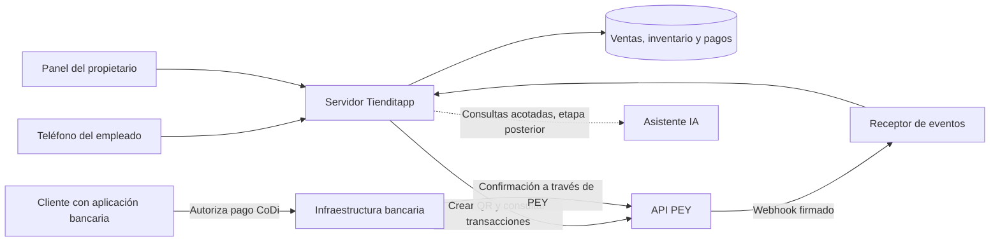

# Tienditapp

**Cobros verificados, ventas e inventario para la tiendita de barrio, desde un teléfono.**


Proyecto para el hackatón **DevDay Exchange México 2026**, con **PEY como patrocinador y proveedor de la API de pagos**. La propuesta es convertir cada cobro en un registro útil para administrar el negocio: quién vendió, qué productos salieron, cuánto se recibió y qué necesita reponerse.

**Estado al 7 de noviembre de 2026, 15:30:** la app del MVP vive en [`app/`](app/README.md) (Python/FastAPI) y ya crea cobros reales con pey. Primer pago real: $0.01 por CoDi, `PAID` a las 15:08. El manual para agentes y personas es [`AGENTS.md`](AGENTS.md); las decisiones, en [`docs/decisiones/`](docs/decisiones/).

## El reto del hackatón

El brief compartido plantea demostrar una integración funcional con PEY y una transacción de prueba, junto con una explicación de cómo la solución podría convertirse en un negocio sostenible. Señala como entrega el **domingo 8 de noviembre de 2026 a las 13:00**; el horario y los requisitos deben cotejarse con las bases oficiales del evento.

La demostración propuesta se concentra en **una tiendita, un teléfono y un cobro confirmado**, seguido por la actualización de ventas, inventario y caja. “Tiendita de la Esquina” es el comercio ficticio utilizado para presentar Tienditapp.

## Negocio: el problema y la propuesta de valor

Las conversaciones identifican problemas cotidianos de los pequeños comercios: dependencia del efectivo y del cambio, inventarios manuales, diferencias entre ventas y dinero recibido, dificultad para supervisar a varios empleados y desconfianza hacia herramientas financieras complejas. Son observaciones del equipo que deberán validarse con comerciantes.

Tienditapp propone aprovechar el teléfono que el comerciante ya utiliza, con una experiencia sencilla y una confirmación de pago comprensible. El objetivo es reducir la inversión inicial en equipo y facilitar el control del negocio.

| Usuario | Necesidad | Valor propuesto |
| --- | --- | --- |
| Propietario | Saber cuánto se vendió y cobró, incluso cuando está ausente | Panel con ventas, pagos, existencias y actividad por empleado |
| Empleado o familiar | Capturar una venta y comprobar el cobro con pocos pasos | Catálogo sencillo, QR y confirmación visual clara |
| Cliente | Pagar y saber que su compra quedó registrada | Pago mediante un flujo bancario compatible y confirmación del comercio |
| Proveedor, en una etapa posterior | Entender necesidades de abastecimiento | Pedidos y análisis agregado de demanda, sujetos a acuerdos y permisos |

Varios empleados podrían operar desde sus propios teléfonos y dirigir los cobros a la cuenta del propietario. La confianza forma parte del producto: mostrar importe, estado y resultado sin ambigüedad. Las señales sonoras, las recompensas y un indicador físico de confirmación son ideas de evolución.

### Modelo de ingresos por validar

La mesa propuso facilitar la adopción con una inversión inicial baja para el comerciante y explorar ingresos mediante servicios para proveedores: abastecimiento, análisis agregado de ventas, campañas e integraciones. También se discutieron herramientas administrativas adicionales y servicios financieros mediante socios.

Estas son hipótesis comerciales. Aún falta validar quién pagaría, por qué servicio, cuánto y con qué frecuencia; también los costos operativos y las condiciones de PEY. No hay precios, rentabilidad ni acuerdos comerciales confirmados. El uso de datos requeriría permisos claros y controles de acceso; no se plantea entregar historiales identificables de clientes o comercios por defecto.

El piloto debería medir tiempo de cobro, pagos confirmados, diferencias de inventario, errores de caja, uso recurrente y satisfacción del comerciante. Las metas se fijarán después de observar una línea base.

## Producto: alcance propuesto del MVP

El resumen del equipo describe una plataforma amplia. Para el hackatón se propone demostrar primero un recorrido completo:

1. Un empleado entra al comercio de demostración y selecciona productos de un catálogo pequeño.
2. El sistema calcula el total y crea una venta pendiente, asociada al empleado.
3. El servidor solicita un QR de cobro a PEY y lo muestra en el teléfono.
4. El cliente autoriza el pago desde una aplicación bancaria compatible.
5. El servidor verifica la confirmación y la relaciona con la venta.
6. La aplicación muestra el pago confirmado y actualiza una sola vez la venta, el inventario y el corte de caja.
7. El propietario consulta el resultado desde su panel.

| Prioridad | Funcionalidad | Criterio de aceptación propuesto |
| --- | --- | --- |
| Esencial | Comercio de demostración y roles de propietario y empleado | Las ventas quedan asociadas al comercio y al usuario correcto |
| Esencial | Catálogo, existencias y captura de venta | El total se calcula en el servidor y se conservan productos, cantidades y precios |
| Esencial | Cobro QR mediante PEY | Se conserva el identificador del QR y se relaciona con la venta |
| Esencial | Confirmación verificable | Solo un pago validado permite marcar la venta como pagada |
| Esencial | Inventario y corte de caja básicos | Una confirmación repetida no descuenta inventario ni suma ingresos otra vez |
| Extensión | Lectura de códigos de barras con la cámara | El código identifica un producto previamente configurado |
| Extensión | Asistente de IA acotado | Responde una consulta sobre datos registrados o propone una captura que el usuario confirma |

La incorporación de nuevos comercios y cuentas bancarias forma parte del producto previsto. Para la demostración puede utilizarse un comercio preconfigurado, con una cuenta habilitada, sin depender de completar un alta bancaria durante la presentación.

## Tecnología: arquitectura propuesta

Se propone una interfaz web adaptable al teléfono, potencialmente instalable como PWA, un servidor propio y una base de datos transaccional. Elección para el hackatón: Python/FastAPI + SQLite con frontend estático, OpenAI para el dictado ([decisión 0001](docs/decisiones/0001-stack.md)). Instrucciones en [`app/README.md`](app/README.md).



El servidor conservará las credenciales y decidirá qué comercio, cuenta e importe corresponden a cada solicitud. Los teléfonos recibirán únicamente los datos necesarios para operar. La propuesta de Tienditapp no incluye una cartera propia ni la custodia de fondos; el flujo financiero se apoyará en PEY y la cuenta habilitada del comercio.

### Datos y reglas de consistencia

El modelo inicial propuesto incluye comercio, usuario y rol, producto, venta y partidas, intento de cobro, transacción de pago, movimiento de inventario y evento recibido. Deben conservarse por separado el identificador interno de la venta, el del QR y el de cada transacción PEY.

- Calcular importes con precisión decimal o unidades monetarias enteras; evitar errores de punto flotante al sumar precios.
- Validar comercio, relación con la venta, moneda e importe antes de aplicar un pago. Un importe diferente o un pago adicional requiere conciliación.
- Verificar la firma antes de procesar un webhook y deduplicar tanto eventos como transacciones de pago.
- Aplicar venta pagada, movimiento de inventario e ingreso de caja dentro de una operación consistente. Conservar un registro para conciliación y recuperación.
- Mantener un estado pendiente o por conciliar cuando la respuesta sea incierta. La pantalla del cliente o la generación del QR no prueban que el pago terminó.
- Permitir, como evolución, captura local sin conexión y sincronización posterior. La falta de internet nunca debe convertirse en una confirmación de pago.

Estas reglas son criterios de implementación, no capacidades ya desarrolladas.

## Integración con PEY

La [referencia de la API](https://docs.pey.mx/docs/category/api-reference/) y el [contrato OpenAPI](https://docs.pey.mx/openapi.json), versión consultada `2026-10-20`, son las fuentes técnicas. La base de producción es `https://api.pey.mx` y la autenticación utiliza el encabezado `Authorization: Bearer <API_KEY>`.

| Operación | Endpoint | Uso previsto |
| --- | --- | --- |
| Comprobar acceso y consultar pagos | `GET /transaction/api-key` | Validación inicial de solo lectura y conciliación |
| Crear un QR | `POST /codi/qr` | Solicitar el cobro de una venta |
| Consultar pagos de un QR | `GET /transaction/codi/qr/{id}` | Recuperar las transacciones asociadas al QR |
| Consultar una transacción | `GET /transaction/{id}` | Verificar un pago concreto |
| Consultar una cuenta registrada por API | `GET /bank-account/{id}` | Comprobar su estado de habilitación |

Un QR y una transacción tienen identificadores distintos. Las consultas paginadas deben recorrer `nextToken` cuando corresponda. PEY también documenta registro de cuentas, solicitudes push y enlaces de pago, disponibles para ampliar el alcance posteriormente.

Ejemplo de cuerpo para crear un QR de demostración, con monto en MXN:

```json
{
  "amount": 0.01,
  "concept": "Venta demo Tienditapp",
  "expiration": 600,
  "generateImage": false,
  "metadata": {
    "saleId": "demo-001"
  }
}
```

El servidor debe generar y validar la referencia de venta. La respuesta incluye `id` y `qrString`, que permite dibujar el QR. Si se utiliza `bankAccountId`, la cuenta registrada debe estar `ACTIVE`; si se omite, se utiliza la cuenta CoDi vinculada a la clave. Véase [Create QR](https://docs.pey.mx/docs/api/create-qr/).

### Confirmaciones y credenciales

PEY firma las notificaciones con Standard Webhooks. La implementación deberá verificar el cuerpo original de la solicitud con el secreto del webhook y usar `webhook-id` para detectar entregas repetidas. El secreto de firma es distinto de la API key. La configuración admite una URL de webhook por clave. Fuentes: [validación de webhooks](https://docs.pey.mx/docs/webhooks/introduction/) y [configuración](https://docs.pey.mx/docs/tutorials/getting-started/set-up-webhooks/).

Las claves se mantendrán fuera del repositorio y de la aplicación cliente. Para el desarrollo local se acordó un archivo privado en `~/.config/tienditapp/pey-api-key`, con permisos `600`; aún no existe código que lo cargue automáticamente. En un despliegue deberán inyectarse desde la configuración segura del servidor. No deben aparecer en capturas, registros ni material de la demo.

La [guía de PEY](https://docs.pey.mx/docs/tutorials/getting-started/create-an-api-key/) indica que el entorno de pruebas dedicado está pendiente y propone pruebas en producción con montos pequeños, como **$0.01 MXN**. Son operaciones reales. Antes de la demostración debe verificarse la cuenta receptora y utilizar un pagador del equipo.

No se encontró un mecanismo de idempotencia para crear cobros en el contrato revisado. Si una solicitud termina con un tiempo de espera agotado, la implementación deberá conservar el intento incierto y conciliarlo antes de crear otro cobro automáticamente.

## Inteligencia artificial y evolución del producto

La IA se plantea como ayuda para operar y entender el negocio. El primer caso deberá ser pequeño y comprobable: consultar ventas y existencias con lenguaje natural, o convertir un dictado en una propuesta de captura que el empleado revise. La elección sigue pendiente. Los cálculos, permisos y cambios financieros deberán ejecutarse mediante reglas del servidor.

| Etapa propuesta | Capacidades discutidas | Dependencia principal |
| --- | --- | --- |
| MVP del hackatón | Venta, QR, confirmación, inventario y caja | Acceso funcional a PEY y recorrido completo |
| Asistencia al comerciante | Voz, consultas, reportes y alertas de reposición | Datos confiables y acciones supervisadas |
| Operación ampliada | Fiado digital, recordatorios por WhatsApp, roles ampliados y sincronización sin conexión | Permisos, trazabilidad y recuperación de conflictos |
| Relación con proveedores | Pedidos sugeridos, demanda agregada y campañas | Validación comercial y acuerdos sobre datos |
| Investigación posterior | Pronóstico de demanda, visión artificial, gemelo digital, recompensas e indicador físico | Historial suficiente, pruebas de utilidad y privacidad |
| Servicios financieros | Historial comercial para evaluar opciones de financiamiento | Autorización del comercio y socios habilitados |

El escaneo de códigos de barras requiere un catálogo y reglas de presentación: una caja y una unidad no son equivalentes por defecto. El reconocimiento visual de productos es una capacidad distinta que necesita validación propia. El acceso a crédito es una oportunidad futura, no un resultado garantizado.

## Guion de demostración y validación

1. Presentar el problema de la tiendita y la ventaja de operar desde el teléfono.
2. Capturar una venta con productos preparados para la demostración.
3. Generar el QR de PEY y realizar un pago pequeño autorizado por el equipo.
4. Mostrar la confirmación obtenida del servidor y su relación con la venta.
5. Abrir el panel del propietario y mostrar venta, inventario y corte de caja actualizados.
6. Explicar el modelo de ingresos como hipótesis y la evolución hacia IA, fiado y proveedores.

La validación debe centrarse en el comportamiento que se presenta: cobro correcto, firma inválida rechazada, evento repetido sin efectos dobles, importe inesperado sin cierre automático y recuperación después de una interrupción. Si se utiliza una simulación como respaldo de la presentación, deberá identificarse claramente; no sustituye la evidencia de una integración real con PEY.

## Estado y siguientes pasos

| Elemento | Situación al 7 de noviembre de 2026 |
| --- | --- |
| Concepto de negocio y fuentes del equipo | Integrados en este README |
| Identidad del comercio de demostración | Logo y banner JPG disponibles |
| Aplicación, servidor y base de datos | `app/` funciona en local; 12 pruebas automáticas y CI en verde |
| Cuenta receptora | Activa: pey generó QR y recibió un pago real |
| Acceso a la API | `GET /transaction/api-key` con la nueva clave → HTTP 200 (15:00) |
| Webhook y cobro completo | Pago real conciliado (tx `01M6VXE5HTXV66NPJCR1XY7T4A`, 15:08). Webhook firmado implementado; falta URL pública |

Orden propuesto de trabajo:

1. Sustituir la credencial local por la nueva clave completa y validar `GET /transaction/api-key`.
2. Confirmar alcance de la demo, tecnologías y responsables; decidir si cabe un caso acotado de IA.
3. Implementar catálogo, venta pendiente y creación del QR.
4. Publicar el receptor de webhooks, configurar su URL y completar la confirmación y conciliación.
5. Conectar inventario y caja; validar los casos de error relevantes y ensayar la presentación.

## Recursos y fuentes

- [Banner](assets/branding/banner.jpeg): 1600 × 533 píxeles.
- [Logo](assets/branding/logo.jpeg) e [identidad visual](assets/branding/identidadVisual.jpeg); guía en [`GuiaIdentidadGrafica.jpeg`](assets/branding/GuiaIdentidadGrafica.jpeg).
- [Diseño de interfaz de Abarpay](docs/diseno/README.md): maquetas de pantallas, recorridos y sistema de diseño.
- [Brief compartido del equipo: DevDay Exchange México 2026](https://chatgpt.com/s/t_6aef79ee56148191a6c905d73d32fa2b): problema, enfoque móvil, propuestas del equipo, modelo comercial, plazo y recomendación del MVP. Se presenta como diagnóstico, no como decisión final.
- **Resumen de projecto.eml**, proporcionado por el equipo: síntesis de la reunión «Open AI PEY», con inventarios móviles, administración, IA, proveedores, fiado, conectividad y etapas de crecimiento. Incluye recomendaciones del autor además de ideas atribuidas a la reunión.
- [Documentación oficial de PEY](https://docs.pey.mx/): contrato y comportamiento esperado de la integración.

Este documento sintetiza ambos materiales y la preparación técnica de este repositorio. No se han revisado los audios originales; las atribuciones individuales que las fuentes dejan pendientes no se convierten aquí en responsabilidades asignadas. El nombre del producto, el comercio ficticio y sus recursos gráficos corresponden a la preparación de Tienditapp para la demostración.
