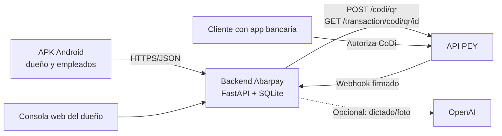

# Abarpay

**Cobros verificados, ventas e inventario para la tiendita de barrio, desde el teléfono.**


Hackatón **DevDay Exchange México 2026** · pagos con **PEY (CoDi)** · IA de **OpenAI** · comercio de demostración **Tiendita de la Esquina** (ficticio).
Entrega: **domingo 8 de noviembre de 2026, 13:00 CDMX**.

> **Estado de esta entrega (8-nov-2026).** La entrega principal es la **app Android** en [`android/`](android/README.md), que consume el backend **FastAPI + SQLite** de [`app/`](app/README.md). La base Android 0.1.1 ya integra login mockup, catálogo, carrito, escáner, texto, QR de PEY y reportes. **Voz, venta en efectivo, fiado, ajustes de inventario y consola owner-only están en la ruta de la demo y se marcan abajo como pendientes** donde corresponde. El backend ya crea QR reales de PEY y verificó un pago de $0.01; la confirmación desde el APK y el webhook público siguen pendientes. Todo lo simulado se etiqueta **SIMULADO**.

## Qué es Abarpay

La tiendita de barrio cobra sobre todo en efectivo, con tickets pequeños y mucha frecuencia. Cuando acepta una transferencia, el dueño tiene que revisar el banco; cuando hay varios empleados, no siempre sabe quién vendió qué ni si la caja cuadra. El inventario vive en la cabeza o en una libreta, y el fiado en otra.

Abarpay convierte el teléfono en la caja de la tiendita: el empleado captura la venta, el servidor calcula el total con el catálogo, el cobro con PEY/CoDi se confirma con el servidor —no con la pantalla del cliente— y la venta queda asociada a quien la hizo. El dueño ve el resultado desde una consola web. La app también debe registrar **ventas en efectivo**, porque son la mayoría del negocio; esa venta se marca como registrada, no como verificada por un banco.

El producto no custodia dinero. El pago CoDi se liquida entre bancos a través de PEY; Abarpay solo crea el cobro, verifica la confirmación y registra la operación. El comercio de demostración, sus productos y sus empleados son ficticios.

## La entrega

| Entregable | Estado | Dónde |
| --- | --- | --- |
| **APK Android** (dueño y empleado) | Base 0.1.1 integrada; APK de desarrollo se compila localmente. Incluye login mockup, inicio, catálogo/carrito, escáner, texto, QR de PEY, inventario de consulta y reportes. Voz, efectivo, fiado, ajustes de inventario y consola owner-only son el objetivo de la demo. | [`android/`](android/README.md) |
| **Backend / API** | FastAPI + SQLite; crea QR de PEY, consulta pagos, verifica webhook firmado, aplica el pago una sola vez y actualiza inventario y reporte. 16 pruebas con PEY simulado. | [`app/`](app/README.md) |
| **Consola web del dueño** | Hoy existe una consola web de demostración en `/`; la versión **solo para el dueño** con la misma API está en construcción. | [`app/static/`](app/static/index.html) |
| **Videos de demostración** | 2 de 3 piezas producidas por el equipo; se entregan por separado. | material externo |
| **Este README** | Documento de entrada para el equipo de PEY y para quien revise el repo. | raíz |

La distribución elegida para la demo es un **APK**, no una tienda de aplicaciones. El APK no contiene claves de PEY ni de OpenAI; esas viven en el servidor.

## Recorrido de la demo

| Paso | Hoy | Objetivo de la entrega |
| --- | --- | --- |
| 1. Entrar | Login/registro **MOCKUP** con perfiles ficticios de dueño y empleado | Mismo recorrido; autenticación real queda para después del hackatón |
| 2. Capturar venta | Texto, código de barras (Google Code Scanner) y botones del catálogo | Agregar dictado por voz (“medio kilo de tortillas”) |
| 3. Cobrar | QR de PEY generado por el servidor | Elegir **efectivo** o **PEY/CoDi**; efectivo se registra y PEY se verifica |
| 4. Confirmar | El APK consulta el estado; el servidor concilia con PEY o recibe webhook firmado | Igual, con la venta en efectivo marcada como registrada |
| 5. Inventario y reporte | Consulta de existencias y reporte del día | Conteo/ajuste simple, corte de caja y fiado básico |
| 6. Dueño | Consola web de demostración | Consola **owner-only** que refleja lo que hacen los teléfonos |

## Arquitectura



- El APK y la consola **no** hablan directo con PEY ni guardan la API key. Solo el backend lo hace.
- El backend conserva la venta, el intento de cobro, el QR, la transacción y el evento recibido por separado.
- SQLite vive en el servidor. El APK no copia la base ni guarda claves.
- La API actual es de **una sola tienda y no autentica**; no debe abrirse a internet con datos reales sin agregar sesiones, permisos y aislamiento.

## Estado actual

### App Android

- Kotlin + Jetpack Compose, Android 8.0/API 26 o superior, paquete `mx.abarpay.mobile.dev`.
- Login/registro **MOCKUP/SIMULADO**: no crea cuentas, no verifica identidad, no usa OAuth.
- Inicio, catálogo, carrito, cantidades, total estimado y confirmación antes de cobrar.
- Escáner con Google Code Scanner y entrada manual de código.
- Texto libre → carrito usando `POST /api/cart/parse`; el servidor decide productos y precios.
- Modo **SIMULADO** sin red ni dinero, y modo **API** contra el backend.
- QR de PEY: el servidor lo crea y el APK lo muestra; el APK consulta el estado cada 3 s.
- Si no recibe `saleId`, conserva el intento y bloquea otro cobro para no duplicar; no borra datos para “resolverlo”.
- Inventario: búsqueda y consulta de existencias. El conteo y ajuste requieren endpoints nuevos.
- Reportes: total del día, cobrado por CoDi, ventas, por persona y productos más vendidos.
- Ajustes: dirección del servidor, aviso de que la API no autentica y modo simulación.

Pendiente en Android: dictado por voz, venta en efectivo, fiado, ajuste de inventario, login real, consola owner-only y prueba en teléfono físico con cámara.

### Backend y base de datos

- `POST /api/sales` calcula el total con el catálogo de SQLite y pide el QR a PEY.
- `GET /api/sales/{id}` concilia con PEY y aplica el pago una sola vez.
- `POST /webhooks/pey` verifica la firma Standard Webhooks, deduplica por `webhook-id` y por transacción.
- `POST /api/barcodes/lookup|link`, `POST /api/cart/parse`, `POST /api/cart/photo`, `GET /api/reports/today` y `GET /api/paid-since`.
- `MODO_DEMO=true` cobra **$0.01 MXN** sin importar el total del carrito; la pantalla lo dice.
- Si PEY no responde al crear el QR, la venta queda `por_conciliar` y no se crea otro cobro automáticamente.
- Pruebas: `python -m pytest -q app/tests` → **16 aprobadas** con `FakePey` etiquetado SIMULADO. La suite cubre totales del servidor, conciliación sin doble descuento, firma inválida/vieja, duplicados, monto distinto, QR desconocido, timeout, QR vencido, reporte, dictado local, códigos de barras y foto sin key.

Limitaciones conocidas del backend: **no hay autenticación ni multitienda**, **no hay venta en efectivo**, **no hay movimientos de inventario** y la conexión SQLite compartida debe endurecerse antes de usarse con varios usuarios o procesos. La recuperación de un intento incierto y la protección contra doble QR también requieren trabajo antes de producción.

Limitaciones de la demo actual:

- El carrito usa **cantidades enteras**. “Medio kilo de tortillas” todavía no se interpreta como 0.5 kg; hoy agregaría una unidad de 1 kg. Para la demo hace falta un SKU de 1/2 kg (la vía rápida) o cantidades decimales con unidad (la vía correcta).
- El escáner en modo API solo encuentra códigos que ya estén en la tabla `barcodes`. La app Android no tiene pantalla para enlazar un código nuevo; la web sí. Para la demo hay que pre-enlazar los códigos o usar el modo simulación (`DEMO-1` a `DEMO-5`).

### Consola web

Hoy `/` sirve la consola de demostración de [`app/static/`](app/static/index.html): inicio, cobro, inventario y reportes. No es owner-only y no autentica. La consola del dueño para la entrega debe reutilizar la misma API y mostrar ventas, efectivo/PEY, inventario y fiado; no debe ser otra base de datos.

## Cómo correr

### 1. Backend con PEY

```bash
python3 -m venv .venv
source .venv/bin/activate
pip install -r app/requirements.txt
cp .env.example .env
```

Edita `.env` (nunca se sube al repositorio):

```dotenv
PEY_API_KEY=...            # obligatoria para crear QR reales
PEY_WEBHOOK_SECRET=...     # necesaria para webhook; opcional si solo se concilia
MODO_DEMO=true             # cobra $0.01 en la demo
# OPENAI_API_KEY=...       # opcional para dictado/foto con OpenAI
```

**La API key va solo en el servidor.** No la pongas en el APK, en `android/`, en `BuildConfig`, en capturas, en logs ni en el chat. Si se filtra, se rota.

Para verificar la clave (sin imprimirla):

```bash
set -a; . ./.env; set +a
curl -s -o /dev/null -w "%{http_code}\n" \
  -H "Authorization: Bearer $PEY_API_KEY" \
  https://api.pey.mx/transaction/api-key
```

Debe responder `200`. Después arranca el backend:

```bash
uvicorn app.main:app --host 0.0.0.0 --port 8000
```

`0.0.0.0` permite que el emulador o un teléfono en la misma red lleguen al servidor. La API no tiene autenticación: úsala solo en una red controlada y no dejes un túnel público abierto sin protección.

### 2. App Android

Requisitos: JDK 17 o 21, Android SDK Platform 35, Build Tools 35.0.0 y Android Studio.

```bash
cd android
./gradlew testDebugUnitTest lintDebug assembleDebug
```

El APK de desarrollo queda en `android/app/build/outputs/apk/debug/app-debug.apk`.

- **Emulador:** en Ajustes de la app usa `http://10.0.2.2:8000`, acepta el aviso de desarrollo y conecta. Es la única excepción HTTP permitida en debug.
- **Teléfono físico:** usa un túnel HTTPS con certificado válido; la app rechaza HTTP fuera del emulador. No desactives la verificación TLS.
- **Sin backend:** elige “Usar simulación sin conexión”. No mueve dinero ni consulta PEY.

La app no incluye claves. Si el backend no tiene `PEY_API_KEY`, el catálogo y los reportes funcionan, pero crear un cobro responde 503.

### 3. Consola web

Abre `http://localhost:8000/`. Es la consola de demostración actual; la versión owner-only se está construyendo. No la expongas a internet sin autenticación.

### 4. Pruebas

```bash
python -m pytest -q app/tests      # 16 pruebas del backend, PEY simulado
./scripts/verificar.sh             # secretos + pruebas
cd android && ./scripts/test-core.sh   # 17 pruebas JVM sin SDK
```

La compilación Android completa y su evidencia histórica están en [`android/VERIFICACION.md`](android/VERIFICACION.md). Las pruebas de Android no llaman a PEY ni mueven dinero.

## Integración con PEY

La base es `https://api.pey.mx` y la autenticación usa `Authorization: Bearer <API_KEY>`.

| Operación | Endpoint | Uso |
| --- | --- | --- |
| Validar acceso | `GET /transaction/api-key` | Comprobar la clave (solo lectura) |
| Crear QR | `POST /codi/qr` | Cobro de una venta |
| Consultar pagos del QR | `GET /transaction/codi/qr/{id}` | Conciliación y respaldo del webhook |
| Consultar transacción | `GET /transaction/{id}` | Verificación puntual |
| Consultar cuenta | `GET /bank-account/{id}` | Estado de la cuenta receptora |

La implementación envía el monto en **pesos** y conserva **centavos** internamente. En modo demo el monto enviado es `0.01`; el total comercial se guarda en `total_cents` y lo cobrado en `charged_cents`.

Ejemplo de creación de QR (el código usa `generateImage: true` para mostrar la imagen en el APK):

```json
{
  "amount": 0.01,
  "concept": "Tiendita de la Esquina",
  "expiration": 600,
  "generateImage": true,
  "metadata": { "saleId": "abc123" }
}
```

La respuesta incluye `id` y la imagen/representación del QR. Un QR y una transacción tienen identificadores distintos; se guardan por separado.

### Confirmación

1. El servidor crea la venta pendiente y pide el QR.
2. El APK consulta `GET /api/sales/{id}` cada 3 s.
3. El servidor concilia con `GET /transaction/codi/qr/{qrId}` o recibe `POST /webhooks/pey`.
4. Solo `apply_payment` marca la venta como pagada, una sola vez, con el monto exacto y descuenta inventario.
5. Si el monto no coincide, la venta queda `por_conciliar`; no se cierra sola.

Webhook: PEY firma con Standard Webhooks. El backend valida `webhook-id`, `webhook-timestamp`, `webhook-signature`, tolerancia de tiempo y deduplica eventos y transacciones. El secreto (`PEY_WEBHOOK_SECRET`) es distinto de la API key. Sin URL pública, la demo funciona por conciliación; el webhook queda implementado pero no registrado.

Limitaciones de la integración actual: PEY no ofrece idempotencia para crear cobros, la API no devuelve `saleId` cuando el POST queda incierto, no se recorre `nextToken` en consultas paginadas y el evento real de webhook no se ha probado con una URL pública. Están documentadas para no presentarlas como resueltas.

## Seguridad y reglas de pago

- **Credenciales solo en `.env` del servidor** (ignorado por git) y variables del deploy. Nunca en el APK, el repositorio, capturas, logs o chats.
- **Cada pago de prueba es dinero real.** PEY no tiene sandbox; se usa **$0.01 MXN** y lo paga una persona desde su app bancaria. Ningún script ni agente paga.
- **Una venta solo pasa a pagada** en `apply_payment`, con un pago verificado por PEY (webhook firmado o conciliación). La pantalla del cliente y el QR no prueban nada.
- **Efectivo no es lo mismo que CoDi.** La venta en efectivo se marca como registrada; no se presenta como verificada por un banco. El corte de caja y la auditoría por empleado son parte del objetivo.
- **Nunca se muestra un monto distinto del cobrado.** En modo demo la pantalla dice “Modo demo: se cobra $0.01”.
- **Lo simulado se etiqueta SIMULADO.** Las pruebas usan `FakePey`; el modo sin conexión no mueve dinero.
- **Cero datos de terceros.** El catálogo y los empleados son ficticios. No se exponen historiales identificables de clientes sin permiso.
- **La API actual no autentica.** No abrirla a internet con datos reales ni con una clave de producción sin sesiones, permisos y aislamiento por tienda.

## Evidencia

| Evidencia | Resultado |
| --- | --- |
| Pruebas del backend | `16 passed` con PEY simulado; CI con gitleaks y pruebas |
| Pago real de PEY | $0.01 MXN, transacción `01M6VXE5HTXV66NPJCR1XY7T4A`, `PAID` a las 15:08 del 7-nov-2026; QR creado por API y conciliado |
| Acceso a PEY | `GET /transaction/api-key` → HTTP 200 con la clave nueva (evidencia del equipo) |
| App Android | Base 0.1.1 compilada y probada según [`android/VERIFICACION.md`](android/VERIFICACION.md); 27 pruebas Android/JVM y 17 sin SDK en la evidencia histórica |
| Prototipo v0.4 | 15 pruebas aprobadas; PEY/OpenAI simulados |
| Prototipo v0.6 | Reporte independiente; rama no fusionada, pagos en vivo no certificados |

Pendiente de verificar antes de presentar como terminado: pago real desde la pantalla del APK, webhook con URL pública, cámara en teléfono físico, voz, efectivo, fiado, ajustes de inventario y consola owner-only.

## Alcance y siguientes pasos

**Para el hackatón:** APK con recorrido de dueño y empleado, catálogo, compra por texto/código/voz, cobro en efectivo y QR de PEY, inventario simple, fiado básico, consola del dueño y videos. La venta real de $0.01 y la confirmación verificada son lo que no se recorta.

**Después del hackatón:** autenticación por passkeys/invitación, tiendas y membresías, corte de caja por turno, movimientos de inventario con auditoría, recibos, conciliación robusta, multi-tienda, datos agregados para proveedores con consentimiento y migraciones de SQLite.

El producto se apoya en PEY y en la cuenta habilitada del comercio; no es una cartera, no custodia fondos y no reemplaza al POS de la tienda.

## Documentación

- [App Android](android/README.md) · [verificación Android](android/VERIFICACION.md) · [arquitectura de identidad y consola](docs/android-arquitectura.md)
- [Backend del MVP](app/README.md) · [decisiones](docs/decisiones/) · [plan de entrega](docs/plan-entrega.md) · [bitácora](docs/bitacora/)
- [Diseño de interfaz](docs/diseno/README.md) · [láminas del pitch](presentacion/README.md)
- [Reporte de evidencia v0.6](docs/Abarpay_v0.6_Functionality_and_Test_Evidence_Report.pdf) · [auditorías](docs/AUDITORIA_PROTOTIPO_FASTAPI_v04.md)
- [Manual para agentes y personas](AGENTS.md)

## Equipo

Mesa de innovación colaborativa: Sergio Arturo Gasca, Carlos del Valle, Ricardo Flores, Agustín Vaquero, Eduardo García, Oswaldo, Luis Murillo y compañeros. Atribuciones por confirmar.

“Tiendita de la Esquina” es un comercio ficticio para la demostración. El nombre, los recursos gráficos y los datos del catálogo corresponden a la preparación de Abarpay para el hackatón.
