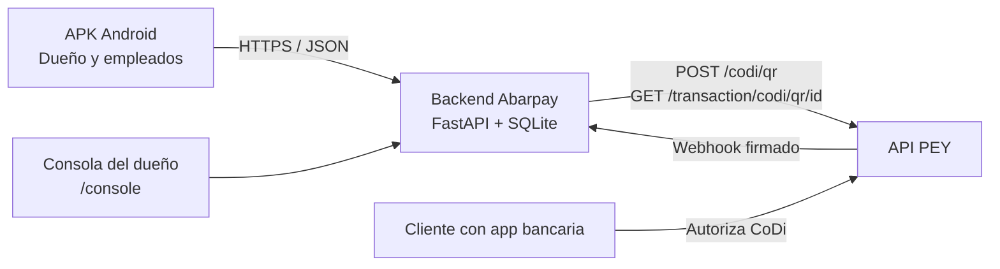

# Abarpay

**Cobros verificados, ventas e inventario para la tiendita de barrio, desde el teléfono.**


Hackatón **DevDay Exchange México 2026** · pagos **PEY (CoDi)** · comercio de demostración **Tiendita de la Esquina** (ficticio).
Entrega: **domingo 8 de noviembre de 2026, 13:00 CDMX**.

> **Estado v1 (8-nov-2026).** La entrega principal es la **app Android** en [`android/`](android/README.md), con un **backend nuevo** en [`server/`](server/README.md) y una **consola del dueño** en [`/console`](server/static/console.html). Efectivo, PEY, fiado, inventario, reportes y consola están implementados y probados en el dispositivo. El **pago real de $0.01 desde la pantalla** se confirmó el **8-nov a las 10:28:34** por conciliación con PEY (tx `01M6XZTYHZC3H4F1FZRYGKGF75`). El webhook real llegó pero respondió **400 `invalid_payload`** por la forma del payload; ya está corregido y verificado con el payload exacto; falta reintentar el evento en el portal. Las decisiones abiertas están en [`docs/pendientes-manana.md`](docs/pendientes-manana.md).

El backend viejo en [`app/`](app/README.md) y los prototipos en [`prototypes/`](prototypes/tiendita-inteligente-pey-v0.4/README.md) quedan como referencia. La app Android ya no los usa.

## Qué es Abarpay

La tiendita de barrio cobra sobre todo en efectivo, con tickets pequeños y mucha frecuencia. Cuando acepta una transferencia, el dueño tiene que revisar el banco; cuando hay varios empleados, no siempre sabe quién vendió qué ni si la caja cuadra. El inventario vive en la cabeza o en una libreta, y el fiado en otra.

Abarpay convierte el teléfono en la caja de la tiendita: el empleado captura la venta con texto, voz, código de barras o botones del catálogo; el servidor calcula el total con sus precios; el cobro PEY/CoDi se confirma con el servidor, no con la pantalla del cliente; y la venta queda asociada a quien la hizo. La app también registra **ventas en efectivo** y **fiado**, porque son la mayoría del negocio. El dueño ve el resultado en una consola web.

Abarpay no custodia dinero. El pago CoDi se liquida entre bancos a través de PEY; Abarpay crea el cobro, verifica la confirmación y registra la operación. El comercio, sus productos y sus empleados son ficticios.

## Arquitectura



- El APK y la consola **no** hablan directo con PEY ni contienen la API key. Solo el backend la usa.
- La venta, los renglones, el intento de cobro, el QR, la transacción y el evento recibido se guardan por separado.
- SQLite vive en el servidor. La app no copia la base ni guarda claves.
- La API v1 es de una sola tienda y no autentica. No exponerla a internet con datos reales sin agregar sesiones, permisos y aislamiento.

## Entregables y estado

| Entregable | Estado | Dónde |
| --- | --- | --- |
| **Backend v1** | Implementado: efectivo, PEY, fiado, inventario, reportes, webhook y consola. 57 pruebas. | [`server/`](server/README.md) |
| **APK Android v1** | Release firmado 1.0.0; instalado y probado en SM-A165M. Servidor de demo fijo y de solo lectura, conexión automática. Cash, PEY QR, fiado, abono, inventario y reportes. | [`android/`](android/README.md) |
| **Consola del dueño** | `/console` con PIN demo 1234 y refresco cada 3 s; ventas, efectivo/PEY/fiado, inventario y equipo. | [`server/static/console.html`](server/static/console.html) |
| **Pago real PEY** | Confirmado por conciliación: `sale_fed4e2ffe9684050b4d6`, tx `01M6XZTYHZC3H4F1FZRYGKGF75`, $0.01 `PAID` a las 10:28:34. El webhook real llegó con 400 `invalid_payload` (payload plano); corregido y verificado con el payload exacto. Falta reintentar el evento en el portal. | Ver [`docs/pendientes-manana.md`](docs/pendientes-manana.md) |
| **Referencia** | App vieja y prototipos; no son la entrega v1. | [`app/`](app/README.md), [`prototypes/`](prototypes/tiendita-inteligente-pey-v0.4/README.md) |
| **Documentación** | Contrato v1, decisiones, bitácora, pendientes y presentación. | [`docs/`](docs/README.md), [`presentacion/`](presentacion/README.md) |

## Flujos de la app

- **Acceso mockup**: dueño o empleado de ejemplo desde `GET /api/bootstrap`. No hay contraseñas, OAuth ni sesiones; el acceso no autentica.
- **Cobrar**: escaneo y dictado primero; texto/código manual quedan en una acción secundaria. Barra fija con artículos, total y salto al cobro; cantidades por presets (incluida media kilo) y billetes rápidos en efectivo. El carrito usa `qtyMilli`; el servidor confirma precios y total.
- **Efectivo**: se captura el efectivo recibido, el servidor calcula el cambio y registra `paid_cash`; no se llama a PEY.
- **PEY/CoDi**: el servidor crea el QR; la app lo muestra y consulta cada 3 s. Solo pasa a éxito con `paid_pey`. En modo demo se cobra **$0.01** y la pantalla lo dice.
- **Fiado**: cliente existente o alta con nombre/teléfono; la venta queda `credit`, con saldo y abonos.
- **Inventario**: consulta y ajuste simple de ±1000 miliunidades; cada cambio deja un movimiento y el stock negativo está permitido en la demo.
- **Reportes**: total registrado, cobrado, efectivo, PEY, fiado, pendientes, fiado por cobrar, por empleado y productos más vendidos.

## Cómo correr

### Backend

Desde la raíz del repositorio:

```bash
python3 -m venv .venv
source .venv/bin/activate
pip install -r server/requirements.txt
# para correr las pruebas:
pip install -r server/requirements-dev.txt
cp .env.example .env
# Editar .env: PEY_API_KEY, PEY_WEBHOOK_SECRET, MODO_DEMO, OWNER_PIN
ABARPAY_LOAD_DOTENV=1 \
ABARPAY_DB=server/data/abarpay.db \
MODO_DEMO=true \
uvicorn server.main:app --host 0.0.0.0 --port 8000
```

- El `.env` nunca se sube al repositorio; `PEY_API_KEY` y `PEY_WEBHOOK_SECRET` viven solo en el servidor.
- `ABARPAY_LOAD_DOTENV=1` es explícito para que las pruebas no lean credenciales reales.
- `OWNER_PIN` es el PIN de demostración de la consola (default 1234).
- La base se crea y se siembra sola si está vacía: una tienda, 3 empleados, 12 productos y 5 códigos de barras.
- Consola: `http://127.0.0.1:8000/console`. El resumen muestra el monto pendiente; `GET /api/console/webhooks?limit=20` audita eventos y `GET /api/console/pending` lista cobros pendientes/por revisar.

Para un teléfono físico hace falta HTTPS. Con un túnel temporal:

```bash
cloudflared tunnel --url http://127.0.0.1:8000
```

La app release ya trae fija la URL actual `https://roughly-participant-sbjct-gain.trycloudflare.com` (campo de solo lectura) y se conecta sola. Usar `.../webhooks/pey` en el portal de PEY. El túnel es efímero: si cambia, actualizar `DEMO_SERVER` en `android/app/build.gradle.kts`, recompilar e instalar; y actualizar el webhook.

### Android

Requisitos: JDK 17 o 21, Android SDK Platform 35, Build Tools 35.0.0, Gradle 8.13.

```bash
cd android
./gradlew assembleDebug
./gradlew testDebugUnitTest
```

Si el wrapper no descarga Gradle en esta red, usar la instalación local:

```bash
cd android
JAVA_HOME=/Library/Java/JavaVirtualMachines/microsoft-21.jdk/Contents/Home \
ANDROID_SDK_ROOT="$HOME/Library/Android/sdk" \
/tmp/gradle-8.13/bin/gradle testDebugUnitTest assembleDebug --no-daemon
```

- Debug: paquete `mx.abarpay.mobile.dev`.
- Release: paquete `mx.abarpay.mobile`, versión 1.0.0; se firma con `~/.config/tienditapp/release.properties` y el keystore local, fuera del repositorio.
- Release: servidor fijo de demo, campo de solo lectura y conexión automática; no hay botón de simulación. Si el túnel cambia, hay que recompilar con el nuevo `DEMO_SERVER`.
- Debug: si hay un servidor guardado lo usa; si no, inicia simulación para las pruebas. La pantalla de Ajustes de esta compilación también queda fijada al servidor de demo.
- APK de release generado en `android/app/build/outputs/apk/release/app-release.apk`.

### Pruebas

```bash
python -m pytest server/tests -q
./scripts/check_v1.sh                 # salud, reporte y consola
./scripts/check_v1.sh <saleId>        # estado de una venta
cd android && ./scripts/test-core.sh
```

- Backend: **57 pruebas** con `FakePey` etiquetado SIMULADO; no llaman a PEY real.
- Android: **46 pruebas Gradle** y **35 pruebas de núcleo JVM** en la evidencia del agente.
- No hay pago real en las pruebas. El pago real de $0.01 lo hace una persona.

## Integración con PEY

Base `https://api.pey.mx`, autenticación `Authorization: Bearer <API_KEY>`.

| Operación | Endpoint | Uso |
| --- | --- | --- |
| Validar acceso | `GET /transaction/api-key` | Comprobar la clave |
| Crear QR | `POST /codi/qr` | Cobro de una venta |
| Consultar pagos del QR | `GET /transaction/codi/qr/{id}` | Conciliación y respaldo del webhook |
| Consultar transacción | `GET /transaction/{id}` | Verificación puntual |
| Webhook | `POST /webhooks/pey` | Confirmación firmada |

- El monto se envía en pesos y se conserva en centavos; en demo el cargo es `0.01` y el total comercial queda en `totalCents`.
- La venta PEY nace `pending`; solo `apply_payment` la pasa a `paid_pey` después de un webhook firmado o una conciliación correcta.
- Webhook Standard Webhooks: se verifican `webhook-id`, `webhook-timestamp` y `webhook-signature` contra `PEY_WEBHOOK_SECRET`; se deduplica por evento y transacción.
- Un monto distinto deja la venta en `por_conciliar`; un pago extra se registra con `applied=0` y nota, no se descarta.
- Un timeout al crear el QR devuelve la venta `por_conciliar` con `saleId`, para no perder la referencia. Sin `qrId` la conciliación automática no es posible y requiere revisión manual.

## Seguridad y reglas de pago

- **Credenciales solo en `.env` del servidor** y variables del deploy. Nunca en el APK, el repositorio, capturas, logs o chats.
- **Cada pago de prueba es dinero real.** PEY no tiene sandbox; se usa **$0.01 MXN** y lo paga una persona desde su app bancaria. Ningún script ni agente paga.
- **Una venta PEY solo pasa a pagada** en `apply_payment`, con un pago verificado por PEY. La pantalla del cliente y el QR no prueban nada.
- **Efectivo no es lo mismo que CoDi.** La venta en efectivo se registra y se marca `paid_cash`; no se presenta como verificada por un banco.
- **Nunca se muestra un monto distinto del cobrado.** En modo demo la pantalla dice “Modo demo: se cobra $0.01”.
- **Lo simulado se etiqueta SIMULADO.** La app tiene modo sin conexión y las pruebas usan `FakePey`.
- **Cero datos de terceros.** El catálogo y los empleados son ficticios.
- **La API v1 no autentica.** No abrirla a internet con datos reales ni dejar el túnel público más de lo necesario.

## Evidencia

| Evidencia | Resultado |
| --- | --- |
| Backend | **57 passed**; smoke de salud, bootstrap, efectivo, consola y webhook firmado |
| Android | Release firmado, instalado y ejecutado en **SM-A165M** (Android 16/API 36); venta en efectivo, fiado, abono, inventario, media kilo de tortillas ($13), código de barras manual 7500000000001 y consola |
| PEY | Pago real de $0.01 confirmado por conciliación: `PAID`, tx `01M6XZTYHZC3H4F1FZRYGKGF75`, 10:28:34 |
| Webhook | El evento real llegó con 400 `invalid_payload` porque PEY envía los campos en la raíz; ya se acepta ese formato y el replay exacto devolvió 200 `duplicate_transaction`; el retry del portal queda pendiente |
| Release APK | `android/app/build/outputs/apk/release/app-release.apk`; 12 MB; SHA-256 `90c60184ddf68c4eb325f2f750bb079e72d49166563c1b6a81ece36866a6de3f`; firma v2 verificada |
| Referencia | Prototipo v0.4: 15 pruebas; v0.6: reporte independiente, no fusionado |

## Limitaciones y decisiones abiertas

- Acceso **mockup** sin autenticación; consola con PIN demo compartido, no sesiones firmadas.
- Una sola tienda; no hay multi-tienda ni aislamiento por comercio.
- El túnel es temporal y expone la app sin auth.
- Falta probar cámara y dictado en un teléfono físico con hardware real (el escáner y la voz están implementados; el flujo manual, el parser y la media kilo sí se probaron).
- Las ventas PEY pendientes cuentan en el total “registrado” del reporte; “Cobrado” solo suma efectivo + PEY pagado. Ver decisión 2 en [`docs/pendientes-manana.md`](docs/pendientes-manana.md).
- No hay corte de caja/arqueo, reembolsos ni edición de catálogo.
- El webhook real de PEY **sí llegó**, pero respondió 400 `invalid_payload` porque envía `codiQrId`, `transactionId` y `amount` en la raíz, no en `data`. Ya se corrigió y el replay exacto dio 200; falta que el portal reintente el evento para cerrar la evidencia del webhook.

## Repositorio

| Ruta | Qué es |
| --- | --- |
| [`server/`](server/README.md) | Backend v1 FastAPI + SQLite y consola. |
| [`android/`](android/README.md) | App Android v1 (Kotlin/Compose). |
| [`docs/v1-contract.md`](docs/v1-contract.md) | Contrato de API, datos y supuestos. |
| [`docs/pendientes-manana.md`](docs/pendientes-manana.md) | Pago pendiente y decisiones para la mañana. |
| [`app/`](app/README.md) | MVP anterior; referencia. |
| [`prototypes/`](prototypes/tiendita-inteligente-pey-v0.4/README.md) | Prototipos; referencia. |
| [`presentacion/`](presentacion/README.md) | Láminas del pitch. |
| [`docs/diseno/`](docs/diseno/README.md) | Maquetas y sistema de diseño. |

## Equipo

Mesa de innovación colaborativa: Sergio Arturo Gasca, Carlos del Valle, Ricardo Flores, Agustín Vaquero, Eduardo García, Oswaldo, Luis Murillo y compañeros. Atribuciones por confirmar.

“Tiendita de la Esquina” es un comercio ficticio para la demostración. El nombre, los recursos gráficos y los datos del catálogo corresponden a la preparación de Abarpay para el hackatón.
