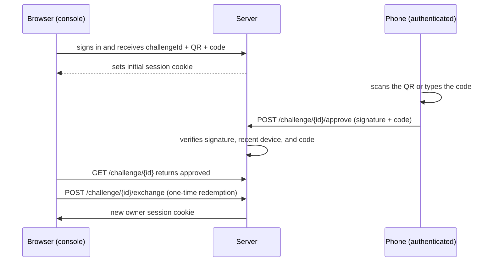

# 04 · Identity, onboarding, and pey (OIDC, devices, and bank account)

Status: handoff package for the DSH team. Written 21-nov-2026. Implementation instructions for production. It does not modify the current demo code.

## Purpose

Replace the simulated access (`X-Employee-Id` and console PIN) with real identity via OpenID Connect, link devices with QR approval, and register the business CLABE bank account with pey to route CoDi charges per tenant. Tenancy and isolation are defined in `02-contratos-y-tenencia.md`.

## Inherited context

- The demo authenticates with the `X-Employee-Id` header and the console with `X-Owner-Pin` (`docs/decisiones/0005-v1-android-backend-consola.md`).
- `server/pey.py` already implements `PeyClient` and `verify_webhook` with Standard Webhooks. Today `create_qr` does not send `bankAccountId`, which in production is required per tenant.

## Identity providers

### Auth0 (business owners and employees)

- Auth0 covers the business owners and employees. The Android app uses the Authorization Code Flow with PKCE, the recommended flow for native apps.
- Discovery at `https://{tenant}.auth0.com/.well-known/openid-configuration`.
- The access token's `sub` is stored in `users.external_sub` with `idp='auth0'`.

### Microsoft Entra ID (SaaS staff)

- Entra ID covers only the internal staff who operate the SaaS, not the merchants.
- Application registration in Entra. Authority `https://login.microsoftonline.com/{tenant}/v2.0`.
- Discovery at `/.well-known/openid-configuration` and keys at `/discovery/v2.0/keys`.
- `oid` plus `tid` form `external_sub` with `idp='entra'`.

Boundary rule: signing in to the Entra staff realm never grants a business membership. SaaS staff operate the SaaS console, not the stores, and any exceptional support operation uses auditable internal permissions with temporary scope. An operator who is also a merchant takes on that role with their independent Auth0 identity.

## Access token validation (backend as resource server)

- The API validates the access token, not the ID token. The access token carries `aud` equal to our API's audience.
- `iss`, `aud`, `exp`, `nbf` (when present), and the RS256 signature are validated against the JWKS with caching and rotation by `kid`. `alg=none` is rejected and clock drift is bounded.
- The subject maps to `users.external_sub`: `sub` in Auth0 and `oid` plus `tid` in Entra. For Auth0, the active `membership` and the `tenant_id` consumed by RLS are resolved; Entra checks internal role, MFA, and platform-exclusive audience (`02-contratos-y-tenencia.md`).
- The ID token is client material. The backend never accepts it as an API credential.

## Device linking and approval

Each device generates a key pair in Android Keystore on first access and registers the public key. QR approval links the browser and the phone without shared passwords.

### Browser challenge with an initial cookie and one-time redemption

- The browser requests a challenge and the server sets an initial session cookie (HttpOnly, Secure, SameSite) before showing the QR.
- The challenge expires in at most 120 seconds and is approved once. The redemption code is consumed exactly once.
- A short matching code is shown in the browser and on the phone so the user confirms they are approving the right session.
- If the QR cannot be scanned, a manual fallback exists on the same device or across devices by entering the code.

### Contracts

- `POST /api/auth/device/register` body `{deviceId, publicKey, label}` → registers the device for the current token.
- `POST /api/auth/challenge` body `{intent:'browser_login'|'device_link'}` → creates `{challengeId, code, qr, expiresAt}` and sets the initial session cookie.
- `GET /api/auth/challenge/{challengeId}` → challenge state for the browser to poll.
- `POST /api/auth/challenge/{challengeId}/approve` body `{deviceSignature, code}` → the authenticated phone signs the challenge and confirms the code.
- `POST /api/auth/challenge/{challengeId}/exchange` → the browser with its cookie redeems the challenge once and receives a rotated session cookie that is HttpOnly, Secure, and SameSite. The web app keeps tokens out of JavaScript and browser storage.
- `DELETE /api/auth/devices/{deviceId}` → revokes a device and its sessions.

### Browser approval flow



Rules:

- Approval requires a device with recent authentication. A device without recent authentication re-authenticates before approving.
- The device signature covers challengeId, nonce, expiration, purpose, and chosen store. Show the store and browser before local authentication. The server checks an active owner and a current device when approving and redeeming, binds the redemption to the original cookie, and consumes the challenge in a transaction. Limit manual-code attempts and per-origin requests. Protect web session mutations against CSRF.
- Access recovery uses the provider's managed OIDC (re-authentication and MFA in Auth0 or Entra). When replacing a phone, revoke the previous device's authorizations and its browser sessions, and notify the owner through the verified channel.

## Business onboarding

1. Signup in Auth0 (owner) and creation of the tenant and store in `02-contratos-y-tenencia.md`.
2. Register the device, capture the first item, and complete a cash sale. Save progress between steps.
3. Offer CLABE registration, email invitation, and optional consent as independent tasks. The store can take cash and run fiado before enabling CoDi.

## Bank account with pey

### Official pey contract

Source: <https://docs.pey.mx/docs/api/register-bank-account>.

- `POST /bank-account` with `Authorization: Bearer <api-key>`. The documentation defines the bearer scheme for the API key in that header.
- Body with exactly four fields: `alias`, `name`, `clabe`, and `entity`. `entity` is `BUSINESS` or `PERSON`.
- `clabe` is 18 digits with a valid check digit and a CoDi-enabled bank.
- Response `{id, codiStatus}`. Registration with Banxico takes up to 5 business days.
- `GET /bank-account/{id}` returns `{id, alias, name, clabe, entity, taxId?, codiStatus, errorMessage?, dateCreated}`. `taxId` appears only if it was provided, and the creation call does not accept it.

### States

| State | Meaning | Action |
| --- | --- | --- |
| `PENDING` | Received, not yet sent to Banxico | Keep polling |
| `PROCESSING` | Registration with Banxico in progress | Keep polling |
| `ACTIVE` | Registered and able to receive payments | Mark as the tenant's active account |
| `ERROR` | Registration failed | Show `errorMessage` and decide with the owner |

### Polling and webhook

- The `bank.account.updated` webhook arrives only on the transition to `ACTIVE` and is verified with Standard Webhooks. `PENDING`, `PROCESSING`, and `ERROR` do not fire a webhook, so polling remains mandatory.
- Polling plan: immediately after creation, then every 6 hours and every 24 hours, up to 5 business days plus margin, with backoff retries.

Activation webhook payload:

```json
{
  "type": "bank.account.updated",
  "bankAccountId": "<id-cuenta-SIMULADO>",
  "name": "Empresa SA de CV",
  "ownerType": "API_KEY",
  "ownerId": "<id-propietario-SIMULADO>",
  "codiStatus": "ACTIVE",
  "clabe": "<18 dígitos>",
  "entity": "BUSINESS"
}
```

The reader tolerates optional fields such as taxId and discards them when not needed for the operation. They are not included in the creation request.

### Activation evidence

- The record of the received webhook is kept (receipt, payload hash, and `bankAccountId`) and deduplicated by `webhook-id`.
- The account only moves to `ACTIVE` with signed, known evidence: a verified `bank.account.updated` webhook for a known `bankAccountId`, or a verified `GET /bank-account/{id}` returning `ACTIVE` for a known `bankAccountId`. No other source changes the state.

### Internal Abarpay contracts

- `POST /api/tenant/bank-account` (owner) body `{alias, name, clabe, entity}` → creates the local row, calls pey, and responds `{bankAccountId, codiStatus}`.
- `GET /api/tenant/bank-accounts` (owner) → lists `{bankAccountId, alias, name, entity, codiStatus, last4}`.
- `GET /api/tenant/bank-account/{id}` (owner) → local state and reconciliation against `GET /bank-account/{id}` only when there is an `id`.
- `POST /webhooks/pey` processes the signed activation and QR-charge events that the version's contract supports. Deferred payment-method events do not change sales or stock.

### Mandatory active account per tenant

- Every CoDi charge resolves the tenant's `ACTIVE` account and sends it as `bankAccountId` in `POST /codi/qr`.
- If the tenant has no `ACTIVE` account, creating the charge responds 409 with `code: NO_ACTIVE_BANK_ACCOUNT` and does not create the QR.
- `bankAccountId` is never omitted in multi-tenant. Omitting it would leave the charge on the API key's default account and mix tenant funds.

To register or replace an account, require recent owner re-authentication, show the alias and last four digits, and keep an audit trail without the full data. A pending replacement does not automatically replace the previous charge's reference: the destination pointer changes atomically when the substitute is activated. Persist per sale the receiving account used, the transaction identifier, and the actual amount; validate the link when applying payment or reconciliation. An event for an unknown account is quarantined without being assigned to a store by name or suffix.

### CLABE protection

- After registering with pey, `id`, `alias`, `name`, `entity`, and `codiStatus` are kept, plus the last 4 digits for display. The full CLABE is not persisted.
- The CLABE never appears in logs or public responses. It is shown masked.

### Local CLABE validation

- 18 digits and a check digit with the 3-7-1 weights repeated over the first 17 digits, modulo 10. The check digit is `(10 - (sum mod 10)) mod 10`.
- Local validation rejects before calling pey and does not replace pey's validation.

## Failure modes and recovery

| Failure | Behavior | Recovery |
| --- | --- | --- |
| `400 INVALID_CLABE` or `INVALID_PARAMETER` | The registration is marked rejected | The error is shown with no automatic retry |
| `503 SERVICE_UNAVAILABLE` | pey is under maintenance | Retry with backoff |
| Timeout with no `id` returned | Uncertain state and no identifier | Marked for manual reconciliation. It is not queried by `id` nor blindly re-registered |
| `codiStatus = ERROR` | `errorMessage` is exposed | The owner decides to fix and re-register. There is no automatic retry |
| Duplicate webhook | Deduplicated by `webhook-id` | No double transition |
| Webhook for an unknown account | It is recorded and reconciled | `GET /bank-account/{id}` confirms the state when there is an `id` |
| OIDC token with invalid `aud` or `exp` | Rejected with 401 | No session or tenant context is created |

## Acceptance criteria

- [ ] The Auth0 flow and the Entra flow validate access tokens with the API audience and map to `users`.
- [ ] A token with invalid `aud`, `exp`, or signature is rejected without creating a session.
- [ ] An Entra staff login creates no business `membership`.
- [ ] Browser approval uses the initial cookie, the redemption is single-use, and the matching code is verified.
- [ ] The manual fallback works when the QR cannot be scanned.
- [ ] A device without recent authentication cannot approve.
- [ ] Recovery relies on the provider's OIDC and there is no custom backup-code system.
- [ ] With `FakePey` marked SIMULADO, registration moves from `PENDING` to `ACTIVE` by polling and by signed webhook, with deduplication.
- [ ] The account only moves to `ACTIVE` with signed, known evidence.
- [ ] Registration uses exactly `alias`, `name`, `clabe`, and `entity`.
- [ ] A CoDi charge always sends the tenant's ACTIVE `bankAccountId` and fails with 409 if it does not exist.
- [ ] No test registers real accounts or calls `api.pey.mx`. Test CLABEs pass through the validator and are marked SIMULADO.
- [ ] There is no CLABE, RFC, or any key in logs, responses, or commits.

## Gates

- [ ] Identity suite with test JWKS (no network) for both providers.
- [ ] Bank account suite with `FakePey` covering states, signed webhook, duplicate, unknown, and timeout without `id`.
- [ ] CI secret scan that fails on CLABE, RFC, or keys.
- [ ] Device test that verifies revocation, challenge expiration, and single-use redemption.
- [ ] Manual review that `POST /codi/qr` is never invoked without `bankAccountId` in multi-tenant.

## Provenance

- pey · Register Bank Account: <https://docs.pey.mx/docs/api/register-bank-account>
- pey · Get Bank Account: <https://docs.pey.mx/docs/api/get-bank-account>
- pey · Bank account (type and states): <https://docs.pey.mx/docs/types/bank-account>
- pey · Bank account updated webhook: <https://docs.pey.mx/docs/webhooks/bank-account/updated>
- pey · Create QR (`bankAccountId` field): <https://docs.pey.mx/docs/api/create-qr>
- pey · Webhook CoDi QR: <https://docs.pey.mx/docs/webhooks/codi/qr>
- pey · Webhooks (Standard Webhooks): <https://docs.pey.mx/docs/webhooks/introduction>
- Auth0 · Authorization Code Flow with OIDC: <https://auth0.com/docs/authenticate/login/oidc-conformant-authentication/oidc-adoption-auth-code-flow>
- Microsoft · OpenID Connect on the identity platform: <https://learn.microsoft.com/en-us/entra/identity-platform/v2-protocols-oidc>
- CLABE · verification with 3-7-1 weights modulo 10: <https://www.fintoc.com/mx/recursos/guias/como-verificar-la-clabe-antes-de-transferir>

## Locked decisions

- Auth0 covers the business owners and employees. Entra covers only the SaaS staff and grants no business memberships.
- The API validates access tokens with audience, not ID tokens.
- Bank account registration uses four fields and activation requires signed, known evidence.
- Access recovery uses the provider's managed OIDC.
