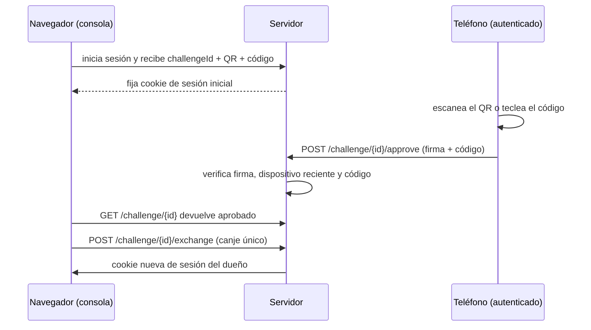

# 04 · Identidad, onboarding y pey (OIDC, dispositivos y cuenta bancaria)

Estado: paquete de handoff para el equipo DSH. Redactado 21-nov-2026. Instrucciones de implementación para producción. No modifica el código del demo actual.

## Propósito

Sustituir el acceso simulado (`X-Employee-Id` y PIN de consola) por identidad real con OpenID Connect, vincular dispositivos con aprobación por QR y registrar la cuenta bancaria CLABE del negocio ante pey para enrutar los cobros CoDi por tenant. La tenencia y el aislamiento se definen en `02-contratos-y-tenencia.md`.

## Contexto heredado

- El demo autentica con el header `X-Employee-Id` y la consola con `X-Owner-Pin` (`docs/decisiones/0005-v1-android-backend-consola.md`).
- `server/pey.py` ya implementa `PeyClient` y `verify_webhook` con Standard Webhooks. Hoy `create_qr` no envía `bankAccountId`, que en producción es obligatorio por tenant.

## Proveedores de identidad

### Auth0 (dueños y empleados del negocio)

- Auth0 cubre a los dueños y a los empleados del negocio. La app Android usa Authorization Code Flow con PKCE, el flujo recomendado para aplicaciones nativas.
- Descubrimiento en `https://{tenant}.auth0.com/.well-known/openid-configuration`.
- `sub` del access token se guarda en `users.external_sub` con `idp='auth0'`.

### Microsoft Entra ID (personal del SaaS)

- Entra ID cubre únicamente al personal interno que opera el SaaS, no a los comercios.
- Registro de aplicación en Entra. Autoridad `https://login.microsoftonline.com/{tenant}/v2.0`.
- Descubrimiento en `/.well-known/openid-configuration` y claves en `/discovery/v2.0/keys`.
- `oid` más `tid` forman `external_sub` con `idp='entra'`.

Regla de frontera: iniciar sesión en el realm de staff de Entra nunca otorga una pertenencia de negocio. El personal del SaaS opera la consola del SaaS, no las tiendas, y cualquier operación de soporte excepcional usa permisos internos auditables y alcance temporal. Un operador que también sea comerciante entra en esa función con su identidad Auth0 independiente.

## Validación del access token (backend como resource server)

- El API valida el access token, no el ID token. El access token lleva `aud` igual a la audiencia de nuestra API.
- Se validan `iss`, `aud`, `exp`, `nbf` (si está) y la firma RS256 contra el JWKS con caché y rotación por `kid`. Se rechaza `alg=none` y se acota la deriva de reloj.
- El subject se mapea a `users.external_sub`: `sub` en Auth0 y `oid` más `tid` en Entra. Para Auth0 se resuelve la `membership` activa y el `tenant_id` que consume RLS; Entra comprueba rol interno, MFA y audiencia exclusiva de plataforma (`02-contratos-y-tenencia.md`).
- El ID token es material del cliente. El backend nunca lo acepta como credencial de API.

## Vinculación y aprobación de dispositivos

Cada dispositivo genera un par de claves en Android Keystore al primer acceso y registra la clave pública. La aprobación por QR une el navegador y el teléfono sin contraseñas compartidas.

### Reto de navegador con cookie inicial y canje único

- El navegador solicita un reto y el servidor le fija una cookie de sesión inicial (HttpOnly, Secure, SameSite) antes de mostrar el QR.
- El reto expira en un máximo de 120 segundos y se aprueba una sola vez. El código de canje se consume exactamente una vez.
- Se muestra un código corto de coincidencia en el navegador y en el teléfono para que el usuario confirme que aprueba la sesión correcta.
- Si no se puede escanear el QR, existe un respaldo manual en el mismo dispositivo o entre dispositivos con la introducción del código.

### Contratos

- `POST /api/auth/device/register` body `{deviceId, publicKey, label}` → registra el dispositivo del token actual.
- `POST /api/auth/challenge` body `{intent:'browser_login'|'device_link'}` → crea `{challengeId, code, qr, expiresAt}` y fija la cookie de sesión inicial.
- `GET /api/auth/challenge/{challengeId}` → estado del reto para que el navegador sondee.
- `POST /api/auth/challenge/{challengeId}/approve` body `{deviceSignature, code}` → el teléfono autenticado firma el reto y confirma el código.
- `POST /api/auth/challenge/{challengeId}/exchange` → el navegador con su cookie canjea el reto una vez y recibe una cookie de sesión rotada HttpOnly, Secure y SameSite. La aplicación web mantiene tokens fuera del JavaScript y del almacenamiento del navegador.
- `DELETE /api/auth/devices/{deviceId}` → revoca un dispositivo y sus sesiones.

### Flujo de aprobación del navegador



Reglas:

- La aprobación exige un dispositivo con autenticación reciente. Un dispositivo sin autenticación reciente vuelve a autenticarse antes de aprobar.
- La firma del dispositivo cubre challengeId, nonce, expiración, propósito y tienda elegida. Mostrar tienda y navegador antes de la autenticación local. El servidor comprueba dueño activo y dispositivo vigente al aprobar y al canjear, vincula el canje a la cookie original y consume el reto en una transacción. Limitar intentos de código manual y solicitudes por origen. Proteger mutaciones de sesión web frente a CSRF.
- La recuperación de acceso se hace con el OIDC gestionado del proveedor (re-autenticación y MFA en Auth0 o Entra). Al reemplazar un teléfono revocar las autorizaciones del dispositivo anterior y sus sesiones de navegador, y avisar al dueño por el canal verificado.

## Onboarding del negocio

1. Alta en Auth0 (dueño) y alta del tenant y de la tienda en `02-contratos-y-tenencia.md`.
2. Registrar el dispositivo, capturar el primer artículo y completar una venta en efectivo. Guardar el avance entre pasos.
3. Ofrecer como tareas independientes el registro CLABE, la invitación por correo y el consentimiento opcional. La tienda puede cobrar efectivo y operar fiado antes de activar CoDi.

## Cuenta bancaria ante pey

### Contrato oficial de pey

Fuente: <https://docs.pey.mx/docs/api/register-bank-account>.

- `POST /bank-account` con `Authorization: Bearer <api-key>`. La documentación define el esquema bearer para la API key en ese header.
- Body con exactamente cuatro campos: `alias`, `name`, `clabe` y `entity`. `entity` es `BUSINESS` o `PERSON`.
- `clabe` son 18 dígitos con dígito verificador válido y banco con CoDi habilitado.
- Respuesta `{id, codiStatus}`. El registro con Banxico tarda hasta 5 días hábiles.
- `GET /bank-account/{id}` devuelve `{id, alias, name, clabe, entity, taxId?, codiStatus, errorMessage?, dateCreated}`. `taxId` aparece solo si se proporcionó, y el alta no lo acepta.

### Estados

| Estado | Significado | Acción |
| --- | --- | --- |
| `PENDING` | Recibida, aún no enviada a Banxico | Seguir sondeando |
| `PROCESSING` | Registro con Banxico en curso | Seguir sondeando |
| `ACTIVE` | Registrada y puede recibir pagos | Marcar como cuenta activa del tenant |
| `ERROR` | Falló el registro | Mostrar `errorMessage` y decidir con el dueño |

### Sondeo y webhook

- El webhook `bank.account.updated` llega solo en la transición a `ACTIVE` y se verifica con Standard Webhooks. `PENDING`, `PROCESSING` y `ERROR` no disparan webhook, por lo que el sondeo sigue siendo obligatorio.
- Plan de sondeo: inmediato tras el alta, luego cada 6 horas y cada 24 horas, hasta un plazo de 5 días hábiles más margen, con reintentos con backoff.

Payload del webhook de activación:

```json
{
  "type": "bank.account.updated",
  "bankAccountId": "<id-cuenta-SIMULADO>",
  "name": "Empresa SA de CV",
  "ownerType": "API_KEY",
  "ownerId": "<id-propietario-SIMULADO>",
  "codiStatus": "ACTIVE",
  "clabe": "<18 dígitos>",
  "entity": "BUSINESS"
}
```

El lector tolera campos opcionales como taxId y los descarta si no son necesarios para la operación; no se incluyen en la solicitud de alta.

### Evidencia de activación

- Se conserva el registro del webhook recibido (recepción, hash del payload y `bankAccountId`) y se deduplica por `webhook-id`.
- La cuenta solo pasa a `ACTIVE` con evidencia firmada y conocida: un webhook `bank.account.updated` verificado para un `bankAccountId` conocido, o un `GET /bank-account/{id}` verificado que devuelva `ACTIVE` para un `bankAccountId` conocido. Ninguna otra fuente cambia el estado.

### Contratos internos de Abarpay

- `POST /api/tenant/bank-account` (owner) body `{alias, name, clabe, entity}` → crea la fila local, llama a pey y responde `{bankAccountId, codiStatus}`.
- `GET /api/tenant/bank-accounts` (owner) → lista con `{bankAccountId, alias, name, entity, codiStatus, last4}`.
- `GET /api/tenant/bank-account/{id}` (owner) → estado local y conciliación contra `GET /bank-account/{id}` solo cuando hay `id`.
- `POST /webhooks/pey` procesa los eventos firmados de activación y cobro QR que el contrato de la versión admite. Los eventos de medios diferidos no cambian ventas ni stock.

### Cuenta activa obligatoria por tenant

- Cada cobro CoDi resuelve la cuenta `ACTIVE` del tenant y la envía como `bankAccountId` en `POST /codi/qr`.
- Si el tenant no tiene cuenta `ACTIVE`, el alta del cobro responde 409 con `code: NO_ACTIVE_BANK_ACCOUNT` y no crea el QR.
- Nunca se omite `bankAccountId` en multi-tenant. Omitirlo dejaría el cobro en la cuenta por defecto de la API key y mezclaría fondos de tenants.

Para registrar o reemplazar una cuenta exigir reautenticación reciente del dueño, mostrar alias y últimos cuatro dígitos y conservar auditoría sin el dato completo. Una sustitución pendiente no reemplaza de oficio la referencia del cobro anterior: el puntero de destino cambia atómicamente al activar la sustituta. Persistir por venta la cuenta receptora usada, el identificador de transacción y el importe real; validar el vínculo al aplicar pago o conciliación. Un evento de cuenta desconocida se pone en cuarentena sin asignarlo a una tienda por nombre o sufijo.

### Protección de la CLABE

- Tras registrar en pey, se conservan `id`, `alias`, `name`, `entity` y `codiStatus`, más los últimos 4 dígitos para mostrar. La CLABE completa no se persiste.
- La CLABE nunca aparece en logs ni en respuestas públicas. Se muestra enmascarada.

### Validación local de CLABE

- 18 dígitos y dígito verificador con pesos 3-7-1 repetidos sobre los primeros 17 dígitos, módulo 10. El dígito verificador es `(10 - (suma mod 10)) mod 10`.
- La validación local rechaza antes de llamar a pey y no sustituye la validación de pey.

## Modos de fallo y recuperación

| Fallo | Comportamiento | Recuperación |
| --- | --- | --- |
| `400 INVALID_CLABE` o `INVALID_PARAMETER` | El alta se marca rechazada | Se muestra el error sin reintento automático |
| `503 SERVICE_UNAVAILABLE` | pey en mantenimiento | Reintento con backoff |
| Timeout sin `id` devuelto | Estado incierto y sin identificador | Se marca para conciliación manual. No se consulta por `id` ni se re-registra a ciegas |
| `codiStatus = ERROR` | Se expone `errorMessage` | El dueño decide corregir y re-registrar. No hay reintento automático |
| Webhook duplicado | Se deduplica por `webhook-id` | Sin doble transición |
| Webhook de cuenta desconocida | Se registra y se concilia | `GET /bank-account/{id}` confirma el estado cuando hay `id` |
| Token OIDC con `aud` o `exp` inválidos | Se rechaza 401 | No se crea sesión ni contexto de tenant |

## Criterios de aceptación

- [ ] El flujo de Auth0 y el de Entra validan access tokens con la audiencia de la API y mapean a `users`.
- [ ] Un token con `aud`, `exp` o firma inválidos se rechaza sin crear sesión.
- [ ] Un login de staff de Entra no crea ninguna `membership` de negocio.
- [ ] La aprobación del navegador usa la cookie inicial, el canje es de un solo uso y el código de coincidencia se verifica.
- [ ] El respaldo manual funciona cuando no se puede escanear el QR.
- [ ] Un dispositivo sin autenticación reciente no puede aprobar.
- [ ] La recuperación se apoya en el OIDC del proveedor y no existe un sistema propio de códigos de respaldo.
- [ ] Con `FakePey` marcado SIMULADO, el alta pasa de `PENDING` a `ACTIVE` por sondeo y por webhook firmado, con deduplicación.
- [ ] La cuenta solo pasa a `ACTIVE` con evidencia firmada y conocida.
- [ ] El alta usa exactamente `alias`, `name`, `clabe` y `entity`.
- [ ] Un cobro CoDi siempre envía el `bankAccountId` ACTIVE del tenant y falla con 409 si no existe.
- [ ] Ninguna prueba registra cuentas reales ni llama a `api.pey.mx`. Las CLABE de prueba pasan por el validador y se marcan SIMULADO.
- [ ] No hay CLABE, RFC ni clave alguna en logs, respuestas o commits.

## Puertas

- [ ] Suite de identidad con JWKS de prueba (sin red) para ambos proveedores.
- [ ] Suite de cuentas bancarias con `FakePey` que cubre estados, webhook firmado, duplicado, desconocido y timeout sin `id`.
- [ ] Escaneo de secretos en CI que falla ante CLABE, RFC o claves.
- [ ] Prueba de dispositivo que verifica revocación, expiración del reto y canje único.
- [ ] Revisión manual de que `POST /codi/qr` nunca se invoca sin `bankAccountId` en multi-tenant.

## Proveniencia

- pey · Register Bank Account: <https://docs.pey.mx/docs/api/register-bank-account>
- pey · Get Bank Account: <https://docs.pey.mx/docs/api/get-bank-account>
- pey · Cuenta bancaria (tipo y estados): <https://docs.pey.mx/docs/types/bank-account>
- pey · Webhook Cuenta bancaria actualizada: <https://docs.pey.mx/docs/webhooks/bank-account/updated>
- pey · Create QR (campo `bankAccountId`): <https://docs.pey.mx/docs/api/create-qr>
- pey · Webhook CoDi QR: <https://docs.pey.mx/docs/webhooks/codi/qr>
- pey · Webhooks (Standard Webhooks): <https://docs.pey.mx/docs/webhooks/introduction>
- Auth0 · Authorization Code Flow con OIDC: <https://auth0.com/docs/authenticate/login/oidc-conformant-authentication/oidc-adoption-auth-code-flow>
- Microsoft · OpenID Connect en la plataforma de identidad: <https://learn.microsoft.com/en-us/entra/identity-platform/v2-protocols-oidc>
- CLABE · verificación con pesos 3-7-1 módulo 10: <https://www.fintoc.com/mx/recursos/guias/como-verificar-la-clabe-antes-de-transferir>

## Decisiones fijadas

- Auth0 cubre a dueños y empleados del negocio. Entra cubre solo al personal del SaaS y no otorga pertenencias de negocio.
- El API valida access tokens con audiencia, no ID tokens.
- El alta de cuenta bancaria usa cuatro campos y la activación exige evidencia firmada y conocida.
- La recuperación de acceso usa el OIDC gestionado del proveedor.
