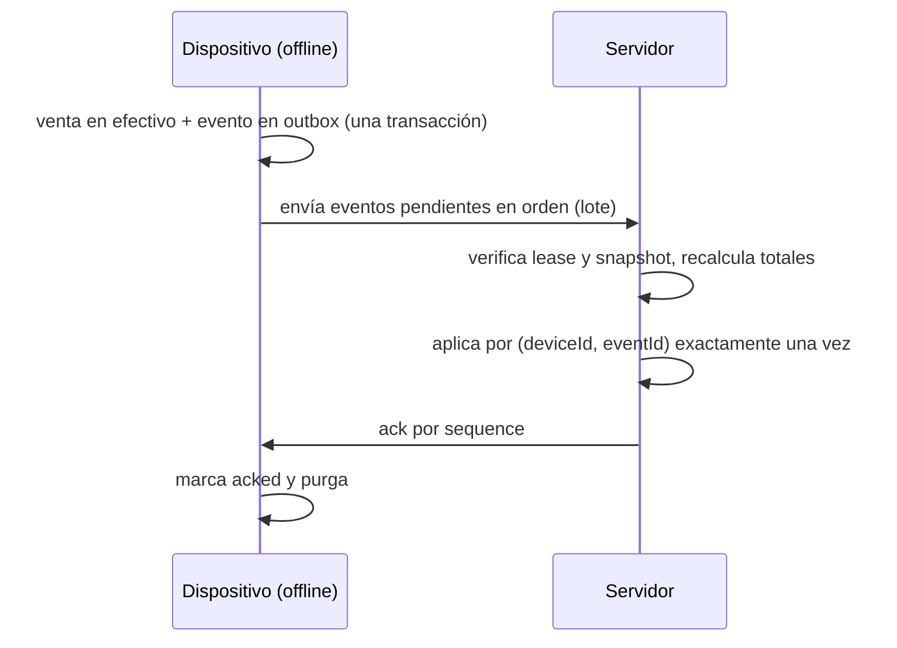

# 05 · Caja offline, inventario, fiado ampliado y corte

Estado: paquete de handoff para el equipo DSH. Redactado 21-nov-2026. Instrucciones de implementación para producción. No modifica el código del demo actual.

## Propósito

Hacer que la caja funcione sin conexión con efectivo finalizado en el dispositivo, registrar entradas de mercancía fuera de línea pendientes de aprobación, y sincronizar con un outbox cifrado y atómico que sobrevive reinicios y actualizaciones. Amplía el fiado con límites, vencimientos, autorización, recordatorios y pagos, añade proveedores, órdenes de compra y recepciones, y formaliza el corte de caja.

## Contexto heredado y reglas de casa

- El contrato v1 exige que todo cambio de stock deje un renglón en `inventory_movements` y que el servidor calcule precios y totales desde la base, sin confiar en precios del cliente (`docs/v1-contract.md`).
- El contrato v2 define inventario con valor precio por existencias, ajuste absoluto y conteo por voz (`docs/v2-contract.md`).
- Las reglas duras del proyecto siguen vigentes: los precios salen de la base, nunca del cliente ni de la IA, y todo lo simulado se etiqueta SIMULADO (`AGENTS.md`).
- El demo permite stock negativo. En producción esa regla se sustituye por la política de última unidad y la varianza de auditoría de este documento.

## Principios offline

- Cuando no hay conexión, el dispositivo es la fuente de verdad local. Una base SQLite cifrada en el dispositivo guarda el estado y una cola de salida (outbox).
- El dispositivo vende solo dentro de una autorización offline firmada por el servidor y con un snapshot canónico de precios también firmado.
- Toda mutación local se confirma en la misma transacción que su evento de outbox. No existe un evento sin estado ni un estado sin evento.
- La sincronización reproduce los eventos en orden y el servidor los aplica exactamente una vez con claves de idempotencia.

## Autorización offline y snapshot de precios firmado

Las 12 horas son únicamente el plazo de una autorización offline (lease). No fuerzan un corte de caja ni un traspaso de turno.

### Lease de autorización offline

Antes de quedar sin conexión, el dispositivo obtiene del servidor un lease firmado:

```json
{
  "v": 1,
  "tenantId": "01HXTENANT000000000000000",
  "storeId": "01HXSTORE0000000000000000",
  "deviceId": "01HXDEVICE0000000000000000",
  "membershipId": "01HXMEMBER000000000000000",
  "issuedAt": 1790724818,
  "expiresAt": 1790768018,
  "signature": "<firma del servidor>"
}
```

- `expiresAt` es `issuedAt + 12 horas`. El servidor firma el lease con su clave de firma y lo vuelve a verificar en cada sincronización.
- Vencido el lease, el dispositivo exige volver a autorizarse en línea antes de registrar más ventas. No implica cierre de caja ni cambio de turno. La recepción física offline requiere la misma autorización de dispositivo y permiso de inventario. Si expira el lease después de finalizar una operación legítima y antes del acuse, conservarla para sincronización o revisión; nunca usar la hora de llegada por sí sola para descartarla. Ante revocación, reloj incoherente o datos corruptos, retener y conciliar sin exponerlos al siguiente usuario.

### Snapshot canónico de precios

Junto al lease, el servidor entrega un snapshot de catálogo firmado:

```json
{
  "v": 1,
  "catalogVersion": 42,
  "asOf": 1790724818,
  "expiresAt": 1790768018,
  "items": [
    { "productId": "01HXPROD000000000000001", "unit": "pieza", "priceCents": 1800, "unlimitedStock": false }
  ],
  "signature": "<firma del servidor>"
}
```

- La venta offline calcula los totales con estos precios. El dispositivo nunca usa un precio tecleado por el cliente ni calculado localmente.
- El evento de venta lleva `catalogVersion`. El servidor revalida la firma y recalcula los totales desde la versión canónica que originó el snapshot, preservada por tenant. Un precio actual posterior nunca sustituye el que se mostró al comprador.
- Una actualización legítima posterior de tarifa no genera un déficit de caja. Si el importe enviado difiere de su propio snapshot, preservar la evidencia local y abrir revisión sin aceptar un precio arbitrario. La venta física no se reescribe.

## Outbox cifrado, atómico y durable

### Estructura

```json
{
  "v": 1,
  "eventId": "01HXYZTXN1234567890RSTUVWX",
  "deviceId": "01HXDEVICE0000000000000000",
  "sequence": 481,
  "type": "sale.created",
  "tenantId": "01HXTENANT000000000000000",
  "storeId": "01HXSTORE0000000000000000",
  "catalogVersion": 42,
  "occurredAt": 1790724818,
  "payload": {}
}
```

- `sequence` es monótono por dispositivo y permite reproducir en orden y detectar huecos.
- `eventId` es un ULID generado por el dispositivo. El servidor lo usa como clave de idempotencia junto con `deviceId`.
- El outbox es de solo anexar. Los eventos confirmados se marcan `acked` y se purgan solo tras confirmación del servidor.

### Cifrado

- Cada evento se cifra con AEAD (AES-GCM) con una clave derivada y custodiada en Android Keystore. El texto en disco nunca muestra el payload en claro.
- El contenedor lleva `v` y una etiqueta de integridad. Un evento corrupto se detecta por el tag y se pone en cuarentena, sin bloquear el resto de la cola.
- La rotación de clave tras una actualización mantiene la lectura de versiones anteriores y re-cifra al escribir.

### Durabilidad

- El archivo del outbox sobrevive al reinicio de la app y a la actualización porque se escribe en almacenamiento interno y se migra por versión de esquema antes de usarse.
- La escritura usa `fsync` o el equivalente de la capa de persistencia antes de reconocer la operación al usuario.

### Sincronización



- El servidor mantiene `outbox_applied(device_id, event_id, applied_at)` con restricción única.
- La transacción central reserva ID y huella canónica del payload, aplica los efectos y guarda la respuesta antes del commit. El mismo evento devuelve el resultado original; el mismo ID con otro contenido se envía a revisión sin mutación. Acusar por operación, no por el mayor número observado.
- Los conflictos se resuelven por tipo de operación y secuencia local, conservando por separado occurredAt y receivedAt. El reloj del teléfono no decide el orden entre cajas ni autoriza operaciones.

## Caja y efectivo offline

- Una venta en efectivo se finaliza en el dispositivo como `paid_cash`, descuenta el stock local y encola `sale.created`.
- El dispositivo asigna referencia estable al finalizar; el servidor puede agregar un número central sin sustituir el folio entregado. El folio nunca se reutiliza y queda estable entre reintentos.
- La venta conserva `occurredAt` del dispositivo como hora de negocio.
- El servidor no reescribe la venta física al sincronizar. Recalcula los totales con precios canónicos y, si difieren del cobro, conserva la venta tal como ocurrió y retiene la diferencia como déficit auditado.

## Inventario

### Venta de la última unidad

- Una venta que consume la última unidad se honra. El stock puede quedar exactamente en 0 y la venta se registra íntegra.
- Si dos cajas desconectadas venden la última pieza, registrar ambas ventas y ambos movimientos centrales. De una unidad inicial se llega a −1. Mostrar varianza al dueño; no truncar a cero, descartar ni retener la segunda venta. Cerrar la varianza con conteo y ajuste motivado. La recepción pendiente no encubre el faltante.

### Varianza de auditoría

- Un conteo físico que difiere del stock del sistema registra un movimiento `inventory_movements` con `reason='audit_variance'` y `delta_milli = contado - sistema`.
- La varianza nunca se corrige en silencio. Queda visible con quién contó, cuándo y la diferencia.

### Recepción de mercancía offline

- Una entrada de mercancía registrada sin conexión se guarda como recepción `awaiting_approval`. No incrementa stock hasta que el dueño la aprueba.
- Al aprobar, el servidor incrementa el stock y escribe `inventory_movements` con `reason='receipt'`.

## Fiado ampliado

### Campos nuevos

- `fiado_customers` añade `credit_limit_cents INTEGER NULL`, `due_days INTEGER NULL`, `active INTEGER NOT NULL DEFAULT 1` y `reminders_consent INTEGER NOT NULL DEFAULT 0`.
- Los cargos `fiado_entries` de tipo `charge` añaden `due_at` (opcional) y `reminded_at` (opcional).

### Fiado offline como borrador

- Un cargo de fiado registrado sin conexión se guarda como `fiado_drafts`, no como `fiado_entries`. No es crédito finalizado hasta que el servidor lo confirma.
- Al sincronizar, el servidor evalúa límite y vencimiento y convierte el borrador en cargo, o lo deja pendiente de autorización. El borrador conserva la intención original y no se reescribe.

### Reglas

- Un cargo no puede superar el límite de crédito disponible. Si lo supera, el sistema responde 409 `CREDIT_LIMIT_EXCEEDED`.
- El dueño puede autorizar una excepción con `POST /api/fiado/overrides`, que deja rastro del motivo y del empleado.
- Los vencimientos se calculan desde `due_days` del cliente o se fijan por cargo.
- Los recordatorios se envían solo con consentimiento del cliente (`reminders_consent`) y se programan a través del outbox. Sin consentimiento no se envía nada.
- Los pagos son abonos parciales o liquidación completa, con `fiado_entries` de tipo `payment` como en v1 y v3.2.

### Contratos

- `PATCH /api/fiado/customers/{id}` body `{creditLimitCents?, dueDays?, active?, remindersConsent?}` (owner o `can_fiado`).
- `POST /api/fiado/customers/{id}/charges` body `{amountCents, dueAt?, note?}` → valida el límite.
- `POST /api/fiado/overrides` (owner) body `{customerId, amountCents, reason}`.
- `GET /api/fiado/reminders?dueWithinDays=7` (owner) → vencidos y próximos con consentimiento.
- `POST /api/fiado/customers/{id}/repayments` body `{amountCents, note?}` (abono o liquidación).

## Proveedores, órdenes de compra y recepción

### Modelo

| Tabla | Propósito |
| --- | --- |
| `suppliers` | Proveedor del tenant |
| `purchase_orders` | Orden con estado `draft`, `issued`, `partial`, `received`, `canceled` |
| `po_lines` | Renglones de la orden con cantidad pedida, recibida y costo unitario |
| `receipts` | Recepción de mercancía con estado `awaiting_approval` o `approved` |
| `receipt_lines` | Renglones recibidos por producto |

### Contratos

- `GET/POST /api/suppliers`, `PATCH/DELETE /api/suppliers/{id}`.
- `POST /api/purchase-orders` body `{supplierId, lines:[{productId, qtyMilli, unitCostCents?}]}`.
- `POST /api/purchase-orders/{id}/issue`, `POST /api/purchase-orders/{id}/cancel`.
- `POST /api/receipts` body `{purchaseOrderId, lines:[{productId, qtyMilli}]}` → crea recepción `awaiting_approval`.
- `POST /api/receipts/{id}/approve` (owner) → registra el costo de compra por renglón, incrementa stock con `reason='receipt'` y avanza la orden a `partial` o `received`.

### Conciliación de tres vías

- Pedido, recepción y factura se comparan por renglón. Una recepción que supera lo pedido se rechaza o requiere autorización. La orden queda `received` cuando todos sus renglones están recibidos.
- El costo de compra en centavos se registra por renglón al aprobar la entrada y alimenta el costo promedio ponderado del informe (09-paquetes-y-aceptacion.md).

## Corte de caja

- El corte de caja es independiente del lease offline de 12 horas.
- Un turno se abre con fondo inicial y se cierra con el efectivo contado.
- `expected_cents = fondo + ventas en efectivo + entradas - salidas`. La varianza es `contado - esperado`.
- No se abre un turno nuevo sin cerrar el anterior.

El cierre en caja captura un recuento ciego y una entrega del empleado. Offline conserva el borrador. Con conexión y operaciones sincronizadas, el dueño acepta la entrega o registra discrepancia con causa. Mantener los estados abierto, contado, entregado, aceptado y observado, con identidad e instante por transición. Un turno aceptado conserva su evidencia.

### Modelo

- `till_shifts(id, tenant_id, store_id, opened_by, opened_at, closed_by, closed_at, opening_float_cents, expected_cents, counted_cents, variance_cents, status)`.
- `till_movements(id, shift_id, kind, amount_cents, sale_id, note, created_at)` con `kind` en `opening`, `cash_in`, `cash_out`, `sale`, `count`.

### Contratos

- `POST /api/till/open` body `{openingFloatCents}` → abre el turno.
- `POST /api/till/close` body `{countedCents}` → registra conteo y entrega, calcula varianza y espera aceptación.
- `POST /api/till/{id}/accept` (dueño) → acepta importe y motivo de diferencia o marca observado, comprobando versión y pendientes.
- `GET /api/till/current` → turno abierto con esperado, contado y varianza.

## Modos de fallo y recuperación

| Fallo | Comportamiento | Recuperación |
| --- | --- | --- |
| Sin conexión durante una venta | La venta queda en el outbox local | Se sincroniza al reconectar, en orden |
| Lease offline vencido | El dispositivo pide autorización en línea | No se fuerzan corte ni traspaso |
| Snapshot de precios sin firma o vencido | El dispositivo no puede vender offline | Vuelve a obtener snapshot y lease |
| Reinicio o actualización de la app | El outbox persiste y se migra | Se continúa desde el último `sequence` |
| Evento duplicado | El servidor no lo vuelve a aplicar | Idempotencia por `(deviceId, eventId)` |
| Hueco en la secuencia | El dispositivo detecta eventos faltantes | Reenvía desde el último ack confirmado |
| Evento corrupto | Se detecta por el tag AEAD | Se pone en cuarentena sin bloquear la cola |
| Precio distinto al snapshot | El servidor recalcula y retiene la diferencia | Déficit auditado, sin reescribir la venta |
| Venta de la última unidad | Stock queda en 0 y la venta se honra | Sin corrección posterior |
| Varianza de conteo | Se registra como `audit_variance` | El dueño revisa y decide |
| Cargo offline que excede el límite | Queda como borrador y se autoriza | El dueño decide al sincronizar |
| Recordatorio sin consentimiento | No se envía | El consentimiento se respeta en el outbox |

## Criterios de aceptación

- [ ] Una venta en efectivo sin conexión se finaliza con precios del snapshot firmado y llega al servidor al reconectar.
- [ ] El servidor recalcula los totales y rechaza una venta con precios alterados, sin reescribir la venta física.
- [ ] Un déficit entre cobro y total canónico se retiene y se audita, no se corrige en silencio.
- [ ] Vencido el lease de 12 horas, el dispositivo pide autorización en línea y no se fuerza cierre ni traspaso.
- [ ] El outbox persiste tras matar la app y tras actualizar de una versión a otra.
- [ ] El archivo del outbox en disco no contiene el payload en claro.
- [ ] Reenviar el mismo lote no duplica ventas ni movimientos.
- [ ] Una venta de la última pieza lleva el stock a cero; dos ventas distintas desde dos POS llevan el saldo a −1 y abren una varianza. Repetir ambos lotes no modifica dinero ni stock.
- [ ] Un conteo distinto registra `audit_variance` y no corrige en silencio.
- [ ] Una recepción offline queda `awaiting_approval` y solo incrementa stock al aprobar.
- [ ] Un cargo offline de fiado queda como borrador y solo se finaliza al sincronizar.
- [ ] Un recordatorio de fiado solo se envía con consentimiento y a través del outbox.
- [ ] El corte de caja calcula la varianza correcta y no permite abrir sin cerrar.

## Puertas

- [ ] Matriz offline en pruebas de dispositivo: venta, recepción, fiado en borrador, reinicio y actualización, cada una con verificación de sincronización.
- [ ] Prueba de idempotencia del outbox con lotes repetidos y secuencias desordenadas.
- [ ] Prueba de cifrado que inspecciona el archivo en disco y exige que no aparezca el payload en claro.
- [ ] Prueba de migración de esquema del outbox entre dos versiones consecutivas.
- [ ] Prueba de snapshot firmado que rechaza precios alterados y lease vencido.
- [ ] Prueba de regresión de inventario que cubre última unidad, varianza y recepción.

## Proveniencia

- Patrón transactional outbox: <https://microservices.io/patterns/data/transactional-outbox.html>
- Android Keystore (custodia de claves del dispositivo): <https://developer.android.com/privacy-and-security/keystore>
- Contrato v1 heredado: `docs/v1-contract.md`
- Contrato v2 heredado: `docs/v2-contract.md`

## Decisiones fijadas

- Las 12 horas son solo el plazo de la autorización offline. No fuerzan cierre de caja ni traspaso de turno.
- La venta offline usa precios de un snapshot canónico firmado por el servidor y nunca montos del cliente.
- La venta física no se reescribe al sincronizar. Los déficits se retienen y se auditan.
- El fiado offline es un borrador hasta la confirmación del servidor. Los recordatorios exigen consentimiento y salen por el outbox.
- Los folios los asigna el servidor o un rango pre-asignado al dispositivo, sin reutilización.
