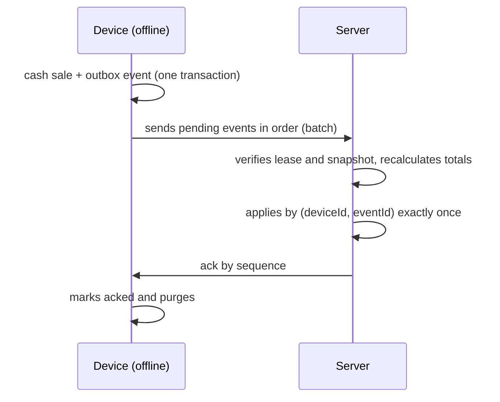

# 05 · Offline till, inventory, extended fiado, and closeout

Status: handoff package for the DSH team. Written 21-nov-2026. Implementation instructions for production. It does not modify the current demo code.

## Purpose

Make the till work offline with cash finalized on the device, record offline goods receipts pending approval, and synchronize with an encrypted, atomic outbox that survives restarts and updates. It extends fiado with limits, due dates, authorization, reminders, and payments, adds suppliers, purchase orders, and receipts, and formalizes the till closeout.

## Inherited context and house rules

- The v1 contract requires every stock change to leave a row in `inventory_movements` and the server to calculate prices and totals from the database, without trusting client prices (`docs/v1-contract.md`).
- The v2 contract defines inventory with value as price times stock, absolute adjustment, and voice count (`docs/v2-contract.md`).
- The project's hard rules remain in force: prices come from the database, never from the client or the AI, and everything simulated is labeled SIMULADO (`AGENTS.md`).
- The demo allows negative stock. In production that rule is replaced by the last-unit policy and the audit variance of this document.

## Offline principles

- When there is no connection, the device is the local source of truth. An encrypted SQLite database on the device holds the state and an outbox.
- The device sells only within an offline authorization signed by the server and with a canonical price snapshot, also signed.
- Every local mutation is committed in the same transaction as its outbox event. There is no event without state and no state without an event.
- Synchronization replays events in order and the server applies them exactly once with idempotency keys.

## Offline authorization and signed price snapshot

The PostgreSQL cash pilot uses the authenticated phone routes `POST /api/owner/pos/{tenantId}/offline-lease` and `POST /api/owner/pos/{tenantId}/offline-sales`. PostgreSQL holds an immutable price snapshot under an opaque lease ID tied to the tenant, verified user, and enrolled device. Android encrypts the cash journal and lease cache using Android Keystore. Checkout assigns the folio before the network request, and sync uses that same checkout key. PostgreSQL validates the recorded time and snapshot on replay. The signed payloads below describe the separate SQLite sync contract.

The 12 hours are only the duration of an offline authorization (lease). They do not force a till closeout or a shift handover.

### Offline authorization lease

Before going offline, the device obtains a signed lease from the server:

```json
{
  "v": 1,
  "tenantId": "01HXTENANT000000000000000",
  "storeId": "01HXSTORE0000000000000000",
  "deviceId": "01HXDEVICE0000000000000000",
  "membershipId": "01HXMEMBER000000000000000",
  "issuedAt": 1790724818,
  "expiresAt": 1790768018,
  "signature": "<firma del servidor>"
}
```

- `expiresAt` is `issuedAt + 12 hours`. The server signs the lease with its signing key and re-verifies it on every sync.
- Once the lease expires, the device requires re-authorizing online before recording more sales. It does not imply a till closeout or a shift change. Offline physical receipt requires the same device authorization and inventory permission. If the lease expires after finishing a legitimate operation and before its acknowledgment, keep it for synchronization or review; never use the arrival time alone to discard it. On revocation, an incoherent clock, or corrupt data, retain and reconcile without exposing them to the next user.

### Canonical price snapshot

Along with the lease, the server delivers a signed catalog snapshot:

```json
{
  "v": 1,
  "catalogVersion": 42,
  "asOf": 1790724818,
  "expiresAt": 1790768018,
  "items": [
    { "productId": "01HXPROD000000000000001", "unit": "pieza", "priceCents": 1800, "unlimitedStock": false }
  ],
  "signature": "<firma del servidor>"
}
```

- The offline sale computes totals with these prices. The device never uses a price typed by the customer or computed locally.
- The sale event carries `catalogVersion`. The server re-validates the signature and recalculates totals from the canonical version that produced the snapshot, preserved per tenant. A later current price never replaces the one shown to the buyer.
- A later legitimate price update does not create a till shortfall. If the submitted amount differs from its own snapshot, preserve the local evidence and open a review without accepting an arbitrary price. The physical sale is not rewritten.

## Encrypted, atomic, durable outbox

### Structure

```json
{
  "v": 1,
  "eventId": "01HXYZTXN1234567890RSTUVWX",
  "deviceId": "01HXDEVICE0000000000000000",
  "sequence": 481,
  "type": "sale.created",
  "tenantId": "01HXTENANT000000000000000",
  "storeId": "01HXSTORE0000000000000000",
  "catalogVersion": 42,
  "occurredAt": 1790724818,
  "payload": {}
}
```

- `sequence` is monotonic per device and allows replay in order and detection of gaps.
- `eventId` is a ULID generated by the device. The server uses it as the idempotency key together with `deviceId`.
- The outbox is append-only. Confirmed events are marked `acked` and purged only after server confirmation.

### Encryption

- Each event is encrypted with AEAD (AES-GCM) using a derived key held in Android Keystore. The text on disk never shows the plaintext payload.
- The container carries `v` and an integrity tag. A corrupt event is detected by the tag and quarantined without blocking the rest of the queue.
- Key rotation after an update keeps reading previous versions and re-encrypts on write.

### Durability

- The outbox file survives app restarts and updates because it is written to internal storage and migrated per schema version before use.
- The write uses `fsync` or the persistence layer's equivalent before acknowledging the operation to the user.

### Synchronization



- The server keeps `outbox_applied(device_id, event_id, applied_at)` with a unique constraint.
- The central transaction reserves the ID and the payload's canonical fingerprint, applies the effects, and saves the response before commit. The same event returns the original result; the same ID with different content is sent to review without mutation. Acknowledge per operation, not by the highest observed number.
- Conflicts are resolved by operation type and local sequence, keeping occurredAt and receivedAt separate. The phone clock does not decide the order between tills nor authorize operations.

## Offline till and cash

- A cash sale is finalized on the device as `paid_cash`, decrements local stock, and enqueues `sale.created`.
- The device assigns a stable reference on completion; the server may add a central number without replacing the delivered folio. The folio is never reused and stays stable across retries.
- The sale keeps the device's `occurredAt` as the business time.
- The server does not rewrite the physical sale on sync. It recalculates totals with canonical prices and, if they differ from the charge, keeps the sale as it happened and retains the difference as an audited shortfall.

## Inventory

### Last-unit sale

- A sale that consumes the last unit is honored. Stock may end exactly at 0 and the sale is recorded in full.
- An online checkout may return 409 `stock_conflict` before taking payment. If two disconnected tills already accepted cash for the last unit, both sales enter the ledger and the second opens a stock variance linked to the sale and product. Stock is checked server-side. A verified CoDi payment also survives an inventory shortage and opens a variance.

### Audit variance

- A physical count that differs from the system stock records an `inventory_movements` row with `reason='audit_variance'` and `delta_milli = counted - system`.
- The variance is never corrected silently. It stays visible with who counted, when, and the difference.

### Offline goods receipt

- A goods receipt recorded offline is saved as an `awaiting_approval` receipt. It does not increase stock until the owner approves it.
- On approval, the server increases stock and writes `inventory_movements` with `reason='receipt'`.

## Extended fiado

### New fields

- `fiado_customers` adds `credit_limit_cents INTEGER NULL`, `due_days INTEGER NULL`, `active INTEGER NOT NULL DEFAULT 1`, and `reminders_consent INTEGER NOT NULL DEFAULT 0`.
- `fiado_entries` charges of type `charge` add `due_at` (optional) and `reminded_at` (optional).

### Offline fiado as a draft

- A fiado charge recorded offline is saved as `fiado_drafts`, not as `fiado_entries`. It is not finalized credit until the server confirms it.
- On sync, the server evaluates the limit and due date and converts the draft into a charge, or leaves it pending authorization. The draft keeps the original intent and is not rewritten.

### Rules

- A charge cannot exceed the available credit limit. If it does, the system responds 409 `CREDIT_LIMIT_EXCEEDED`.
- The owner can authorize an exception with `POST /api/fiado/overrides`, which leaves a trace of the reason and the employee.
- Due dates are computed from the customer's `due_days` or set per charge.
- Reminders are sent only with the customer's consent (`reminders_consent`) and are scheduled through the outbox. Without consent, nothing is sent.
- Payments are partial installments or full settlement, with `fiado_entries` of type `payment` as in v1 and v3.2.

### Contracts

- `PATCH /api/fiado/customers/{id}` body `{creditLimitCents?, dueDays?, active?, remindersConsent?}` (owner or `can_fiado`).
- `POST /api/fiado/customers/{id}/charges` body `{amountCents, dueAt?, note?}` → validates the limit.
- `POST /api/fiado/overrides` (owner) body `{customerId, amountCents, reason}`.
- `GET /api/fiado/reminders?dueWithinDays=7` (owner) → overdue and upcoming with consent.
- `POST /api/fiado/customers/{id}/repayments` body `{amountCents, note?}` (installment or settlement).

## Suppliers, purchase orders, and receipts

### Model

| Table | Purpose |
| --- | --- |
| `suppliers` | Tenant's supplier |
| `purchase_orders` | Order with state `draft`, `issued`, `partial`, `received`, `canceled` |
| `po_lines` | Order lines with ordered and received quantity and unit cost |
| `receipts` | Goods receipt with state `awaiting_approval` or `approved` |
| `receipt_lines` | Lines received per product |

### Contracts

- `GET/POST /api/suppliers`, `PATCH/DELETE /api/suppliers/{id}`.
- `POST /api/purchase-orders` body `{supplierId, lines:[{productId, qtyMilli, unitCostCents?}]}`.
- `POST /api/purchase-orders/{id}/issue`, `POST /api/purchase-orders/{id}/cancel`.
- `POST /api/receipts` body `{purchaseOrderId, lines:[{productId, qtyMilli}]}` → creates an `awaiting_approval` receipt.
- `POST /api/receipts/{id}/approve` (owner) → records the purchase cost per line, increases stock with `reason='receipt'`, and advances the order to `partial` or `received`.

### Three-way reconciliation

- Order, receipt, and invoice are compared per line. A receipt that exceeds what was ordered is rejected or requires authorization. The order becomes `received` when all its lines are received.
- The purchase cost in cents is recorded per line when the receipt is approved and feeds the weighted average cost of the report (09-paquetes-y-aceptacion.md).

## Till closeout

- The till closeout is independent of the 12-hour offline lease.
- A shift opens with an opening float and closes with the counted cash.
- `expected_cents = float + cash sales + inflows - outflows`. The variance is `counted - expected`.
- A new shift is not opened without closing the previous one.

The till closeout captures a blind count and a handover from the employee. Offline keeps the draft. With a connection and synchronized operations, the owner accepts the handover or records a discrepancy with a cause. Keep the states open, counted, delivered, accepted, and observed, with identity and timestamp per transition. An accepted shift keeps its evidence.

### Model

- `till_shifts(id, tenant_id, store_id, opened_by, opened_at, closed_by, closed_at, opening_float_cents, expected_cents, counted_cents, variance_cents, status)`.
- `till_movements(id, shift_id, kind, amount_cents, sale_id, note, created_at)` with `kind` in `opening`, `cash_in`, `cash_out`, `sale`, `count`.

### Contracts

- `POST /api/till/open` body `{openingFloatCents}` → opens the shift.
- `POST /api/till/close` body `{countedCents}` → records count and handover, computes variance, and waits for acceptance.
- `POST /api/till/{id}/accept` (owner) → accepts the amount and difference reason or marks it observed, checking version and pending items.
- `GET /api/till/current` → open shift with expected, counted, and variance.

## Failure modes and recovery

| Failure | Behavior | Recovery |
| --- | --- | --- |
| No connection during a sale | The sale stays in the local outbox | It syncs on reconnect, in order |
| Expired offline lease | The device requests online authorization | No closeout or handover is forced |
| Unsigned or expired price snapshot | The device cannot sell offline | It fetches the snapshot and lease again |
| App restart or update | The outbox persists and migrates | It continues from the last `sequence` |
| Duplicate event | The server does not apply it again | Idempotency by `(deviceId, eventId)` |
| Gap in the sequence | The device detects missing events | It resends from the last confirmed ack |
| Corrupt event | Detected by the AEAD tag | It is quarantined without blocking the queue |
| Price different from the snapshot | The server recalculates and retains the difference | Audited shortfall, without rewriting the sale |
| Last-unit sale | Stock ends at 0 and the sale is honored | No later correction |
| Count variance | Recorded as `audit_variance` | The owner reviews and decides |
| Offline charge that exceeds the limit | It stays as a draft and is authorized | The owner decides on sync |
| Reminder without consent | It is not sent | Consent is respected in the outbox |

## Acceptance criteria

- [ ] An offline cash sale is finalized with prices from the signed snapshot and reaches the server on reconnect.
- [ ] The server recalculates totals and rejects a sale with altered prices, without rewriting the physical sale.
- [ ] A shortfall between the charge and the canonical total is retained and audited, not corrected silently.
- [ ] Once the 12-hour lease expires, the device requests online authorization and no closeout or handover is forced.
- [ ] The outbox persists after killing the app and after updating from one version to another.
- [ ] The outbox file on disk does not contain the plaintext payload.
- [ ] Resending the same batch does not duplicate sales or movements.
- [ ] The first last-unit sale takes stock to zero. When a second till has already accepted cash offline, its sale and payment are retained and the shortage is recorded for review. Repeating both batches adds neither money nor stock movements. Online checkout can still reject a shortage before payment.
- [ ] A different count records `audit_variance` and does not correct silently.
- [ ] An offline receipt stays `awaiting_approval` and only increases stock on approval.
- [ ] An offline fiado charge stays as a draft and is only finalized on sync.
- [ ] A fiado reminder is only sent with consent and through the outbox.
- [ ] The till closeout computes the correct variance and does not allow opening without closing.

## Gates

- [ ] Offline matrix in device tests: sale, receipt, draft fiado, restart, and update, each with sync verification.
- [ ] Outbox idempotency test with repeated batches and out-of-order sequences.
- [ ] Encryption test that inspects the file on disk and requires that the plaintext payload does not appear.
- [ ] Outbox schema migration test between two consecutive versions.
- [ ] Signed snapshot test that rejects altered prices and an expired lease.
- [ ] Inventory regression test covering last unit, variance, and receipt.

## Provenance

- Transactional outbox pattern: <https://microservices.io/patterns/data/transactional-outbox.html>
- Android Keystore (device key custody): <https://developer.android.com/privacy-and-security/keystore>
- Inherited v1 contract: `docs/v1-contract.md`
- Inherited v2 contract: `docs/v2-contract.md`

## Locked decisions

- The 12 hours are only the offline authorization duration. They do not force a till closeout or shift handover.
- The offline sale uses prices from a canonical snapshot signed by the server and never amounts from the client.
- The physical sale is not rewritten on sync. Shortfalls are retained and audited.
- Offline fiado is a draft until server confirmation. Reminders require consent and go out through the outbox.
- Folios are assigned by the server or a range pre-assigned to the device, without reuse.
